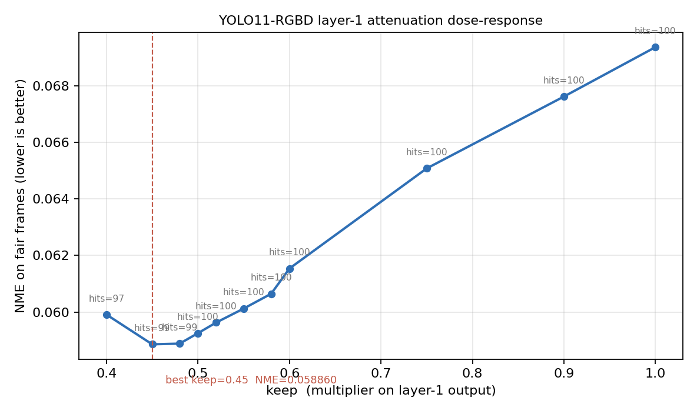

# 02-Multi-YOLO-RGB

对应画布：`yolov8_rgbd_detection/YJJ_DrawIo/02-Multi-YOLO-RGB.drawio`
状态：进行中。最后更新 2026-11-16。

本文档记录实验条件、操作命令、原始数字和结论。所有数字后面标注了来源文件，可直接复核。

---

## 1. 结论摘要

1. 深度对两代模型的作用不同：YOLOv8 上 RGBD 比 RGB 的 NME 低 17.5%；YOLO11 上 RGBD 比 RGB 高 1.6%。
2. YOLO11-RGBD 的第 1 层输出乘 0.5，NME 从 0.070292 降到 0.059823（−14.9%），命中保持 100/100。
3. 第 1 层的收益集中在 ch09~ch16；把 ch09 恢复满强度，NME 回到 0.069703（+17.6%）。
4. 通道性质：ch09 的空间内容与定位无关、幅度有害；ch15 的空间内容参与定位、幅度同样偏大；ch13 的各类干预结果均在噪声范围内。
5. 第 1 层乘 0.5 可以折进第 2 层卷积的输入权重，实测复现 0.059823（逐位一致），不需要重新训练。
6. 把折入后的权重当初始权重再训：起点为已训练权重时 26 轮后 NME 0.073084（比原始更差）；
   起点为干净改造权重时 64 轮后最高框置信度中位数从 0.722 掉到 0.054，统一口径下命中 41/100。
   折入应作为训练后的权重重标定，不作为训练起点。

---

## 2. 资源

### 2.1 权重

| 名称 | 通道 | 起始权重 | 训练脚本 | 文件 |
|---|---|---|---|---|
| `yolov8n_rgb_3ch` | 3 | `yolov8n-pose.pt` | `MultiYoloRGB/train_all.py` | `train_weight/yolov8n_rgb_3ch.pt` |
| `yolo11n_rgb_3ch` | 3 | `yolo11n-pose.pt` | 同上 | `train_weight/yolo11n_rgb_3ch.pt` |
| `yolo26n_rgb_3ch` | 3 | `yolo26n-pose.pt` | 同上 | `train_weight/yolo26n_rgb_3ch.pt` |
| `yolov8n_rgbd_4ch` | 4 | `yolov8n-pose_4ch.pt` | 主仓 `train_rgbd_pose.py` | `train_weight/yolov8n_rgbd_4ch.pt` |
| `yolo11n_rgbd_4ch` | 4 | `yolo11n-pose_4ch.pt` | 主仓 `train_rgbd_pose.py` | `train_weight/yolo11n_rgbd_4ch.pt` |
| `yolo11n_rgbd_4ch_L1x0.5` | 4 | 由上一条折入得到 | `fold_l1_gain.py` | `train_weight/yolo11n_rgbd_4ch_L1x0.5.pt` |

权重指纹：

| 项 | 值 |
|---|---|
| `yolo11n_rgbd_4ch.pt` md5 | `d5dfac630e304b941b106a8c31125523` |
| `yolo11n_rgbd_4ch_L1x0.5.pt` md5 | `438edf6a9a0c4ca35f1c7dc02c2772f4`（11,190,573 B） |
| 首层卷积形状 | `(16, 4, 3, 3)`，输入 4 通道 |
| kpt_shape / nc | `[7, 3]` / `1 = hand` |
| 训练 data | `Resource/session1_200146/dataset/hand/rgbd/data_rgbd.yaml` |
| 训练超参 | 120 ep / imgsz 640 / batch 4 / patience 20 / seed 0 / 增强全关 |

YOLO26 未做 4 通道改造，也没有对应的 RGBD 权重。

4 通道权重由 3 通道权重改造而来，规则：第 1 层卷积输入通道 3→4，前 3 个通道保留原权重，
第 4 个通道取前 3 个通道权重的均值。脚本 `YJJ_Pose_Scripts/02_model/build_rgbd_pose_weights.py`。

### 2.2 数据

| 用途 | 路径 | 数量 |
|---|---|---|
| 训练 / 验证 / 同人测试 | `Resource/session1_200146/dataset/hand` | 52 / 11 / 12 |
| 跨人测试（源） | `Resource/session1_200146/dataset/hand_cross_subject` | test 101 |
| 公共测试集（正式口径） | `Resource/session1_200146/dataset/hand_common` | test 100 |

- RGB 为 `.jpg`，RGBD 为 4 通道 `.png`，按去扩展名的 stem 配对。
- 跨人测试集做过关键点顺序统一：`K0↔K1`、`K3↔K4`，其余不变，101/101 一致。
- 公共测试集 = 参与对比的全部权重都命中的图片交集。

### 2.3 环境

| 项 | 值 |
|---|---|
| 解释器 | `MultiYoloRGB\.venv\Scripts\python.exe`，Python 3.13.5 |
| torch | 2.10.0+cu130 |
| GPU | NVIDIA GeForce RTX 4080 SUPER |
| ultralytics | 8.4.175（`.venv\Lib\site-packages`） |
| 不使用 | 主仓根目录 vendored 的 8.3.176（缺 `cfg/models/26`，无法构建 YOLO26） |

---

## 3. 评估口径

```
推理      conf = 0.05，imgsz = 640
命中      预测框与 GT 框 IoU ≥ 0.50，取 IoU 最大的预测实例
单点误差  d_k = sqrt((x_pred - x_gt)² + (y_pred - y_gt)²)
归一化    nme_k = d_k ÷ GT 框对角线（分母用 GT 框，不用预测框）
参与点    仅 GT visibility > 0 的关键点
单图 NME  图内有效点 nme_k 的均值
最终 NME  公共测试集全部图片的均值，分母 = 公共集张数
```

引用格式：`0.070292（公共集 100 张，conf=0.05，100/100 命中）`。

conf 取值约束：

| conf | 命中 | 说明 |
|---|---|---|
| 0.001 | 100/100 | 11-RGBD 每图输出 175.92 个框，NME 读数偏高约 16% |
| 0.005 ~ 0.05 | 100/100 | 框数 1.00~1.20，两种选框规则结果一致 |
| 0.10 | 96/100 | 命中下降，NME 不可与其他档位直接比较 |
| 0.25 | 85/100 | 同上 |

---

## 4. 脚本与产物

| 脚本 | 用途 | 关键参数 | 产物目录 |
|---|---|---|---|
| `train_all.py` | 三个 RGB 版本训练 | 120 ep / batch 4 / seed 0 | `runs/train/` |
| `eval_versions.py` | 三代首轮对比 | conf 0.001，101 张 | `runs/eval_versions/` |
| `conf_sweep.py` | conf × 选框规则扫描 | conf ∈ {0.001…0.25} | `runs/conf_sweep/` |
| `test_all.py` | 多权重统一测试 | conf 0.05，公共集 100 | `runs/test_all/`、`runs/test_all_fold/` |
| `eval_4ch.py` | 单模型 4 通道评估 | conf 0.001，101 张 | `runs/eval_4ch/` |
| `ablate_depth_nme.py` | 深度五变体消融 | true/zero/spatial/flat/blur | `runs/ablate_depth_nme/` |
| `box_kpt_relation.py` | 框质量与点误差关系 | conf 0.001，全量框 | `runs/box_kpt_relation/` |
| `layer_probe.py` | 层特征统计 | 层 9/10/head | `runs/layer_probe/` |
| `ablate_c2psa.py` | C2PSA 结构旁路 | 两模型 × 开/关 | `runs/ablate_c2psa/` |
| `ablate_layers.py` | 单层输出乘系数 / 旁路 / 混合 | `--mode attenuate --keep 0.5 --layers all` | `runs/ablate_layers/` |
| `ablate_combo.py` | 多层组合干预 | L1+L9 / L1+L10 / 三层 | `runs/ablate_combo/` |
| `compare_all_l1_half.py` | 五模型统一 L1×0.5 对照 | 同条件同图 | `runs/compare_all_l1_half/` |
| `ablate_l1_channel_groups.py` | 第 1 层 32 通道分 4 组 | 每次恢复一组 | `runs/ablate_l1_channel_groups/` |
| `ablate_l1_g2_detail.py` | G2 组内 8 通道逐个恢复 | base 0.5 → restore 1.0 | `runs/ablate_l1_g2_detail/` |
| `ablate_l1_g2_factorial.py` | ch09/13/15 的 2×2×2 | 8 组合 × 两上下文 | `runs/ablate_l1_g2_factorial/` |
| `l1_channel_attribution.py` | 通道归因（内容 + 干预） | shuffle / flatten / 安慰剂 | `runs/l1_channel_attribution/` |
| `fold_l1_gain.py` | 把第 1 层增益折进第 2 层权重 | `--keep 0.5` | `train_weight/*_L1x0.5.pt` |

层干预的实现方式：不改权重、不删结构，把目标层的输出乘一个系数后继续向后传。
`ablate_layers.py:30` 的 `LayerAttenuator.forward` 为 `return out * self.keep`。

每个条件都重新 `YOLO(path)` 加载一次。原因：ultralytics 的 predictor 在 `setup_model` 中执行
`model = deepcopy(model)`（`predictor.py:466`），首次推理后再修改原模型对象不生效，
挂在原模型上的 forward hook 也不会被触发。

---

## 5. 过程

### ① 训练五个权重

操作：

```bat
cd /d H:\YJJ\Yolo_RGBD\MultiYoloRGB
.venv\Scripts\python.exe train_all.py --only yolov8n-pose.pt
.venv\Scripts\python.exe train_all.py --only yolo11n-pose.pt
.venv\Scripts\python.exe train_all.py --only yolo26n-pose.pt
```

4 通道两个在主仓训练：

```bat
cd /d H:\YJJ\Yolo_RGBD\yolov8_rgbd_detection
H:\YJJ\Conda\python.exe YJJ_Pose_Scripts\02_model\build_rgbd_pose_weights.py ^
  --input weights\yolo11n-pose.pt --output yolo11_4ch\yolo11n-pose_4ch.pt

.venv\Scripts\python.exe YJJ_Pose_Scripts\03_train\train_rgbd_pose.py ^
  --data ...\hand\rgbd\data_rgbd.yaml --weights ...\yolo11n-pose_4ch.pt ^
  --fliplr 0.0 --patience 20 --name train_yolo11_rgbd_4ch
```

结果：5 个 `best.pt`。三个版本的 head 类型为 `Pose` / `Pose` / `Pose26`；
YOLO26 的 loss 字段里没有 `dfl_loss`。

### ② 首轮对比（conf=0.001）

```bat
.venv\Scripts\python.exe eval_versions.py
```

| 模型 | 命中 | NME |
|---|---|---|
| YOLOv8n-RGB | 101/101 | 0.081902 |
| YOLO11n-RGB | 100/101 | 0.069727 |
| YOLO26n-RGB | 101/101 | 0.109463 |

同一口径下 4 通道（`runs/eval_4ch/summary.csv`）：v8-RGBD 0.069086、11-RGBD 0.083978。

本轮的判断是"26 最差、11-RGBD 不如 8-RGB"。后续在 conf=0.05 下两条都不成立，见 ③④。

### ③ conf 扫描

```bat
.venv\Scripts\python.exe conf_sweep.py
```

| 模型 | conf=0.001 框数/图 | conf=0.05 框数/图 | NME 0.001 → 0.05 |
|---|---|---|---|
| yolo11n_rgbd_4ch | 175.92 | 1.00 | 0.083996 → 0.070292（−16.3%） |
| yolo26n_rgb_3ch | 7.91 | 1.01 | 0.109463 → 0.079497（−27.4%） |
| 其余三个 | 1.11~1.41 | ~1.0 | 变化 0 ~ −1.8% |

噪声框的 conf 落在 0.001~0.005。conf ≥ 0.005 后两种选框规则（IoU 最大 / conf 最大）结果一致。

修正：测试口径改为 conf=0.05，②的排名作废。

### ④ 五个权重正式排名

```bat
.venv\Scripts\python.exe test_all.py --conf 0.05
```

公共集 100 张，全部 100/100 命中：

| 权重 | 通道 | NME | 与同代 RGB 比较 |
|---|---|---|---|
| `yolov8n_rgbd_4ch` | 4 | 0.067529 | −17.5% |
| `yolo11n_rgb_3ch` | 3 | 0.069164 | — |
| `yolo11n_rgbd_4ch` | 4 | 0.070292 | +1.6% |
| `yolo26n_rgb_3ch` | 3 | 0.079497 | — |
| `yolov8n_rgb_3ch` | 3 | 0.081902 | — |

结论：v8 的 4 通道比 3 通道低 17.5%；11 的 4 通道比 3 通道高 1.6%。
YOLO26 的 NME 低于 YOLOv8-RGB。

### ⑤ 框质量与点误差的关系

```bat
.venv\Scripts\python.exe box_kpt_relation.py
```

| 模型 | 框/图 | 图内 IoU-NME 相关（均值） | 负相关图占比 | oracle 提升 |
|---|---|---|---|---|
| yolo11n_rgbd_4ch | 175.92 | −0.70 | 100% | 17.2% |
| yolov8n_rgbd_4ch | 1.33 | −0.89 | 96% | 1.8% |
| yolo11n_rgb_3ch | 1.11 | +0.27 | 36% | 1.4% |

框 IoU 越大，点的误差越小（相关系数为负）。"取 IoU 最大的预测框"这条规则成立。
11-RGBD 的 oracle 空间为 17.2%，说明它的框质量分布很分散。

### ⑥ 结构旁路（失败）

```bat
.venv\Scripts\python.exe ablate_layers.py --mode identity --layers all
.venv\Scripts\python.exe ablate_c2psa.py
```

结果：

- 19 层中只有第 6/8/9/10 层可以直接换成"原样返回输入"，其余层输入输出通道数不同，
  替换后无法继续前向（`runs/ablate_layers/identity/skipped.csv`，39 条 `shape/type incompatible`）。
- 旁路后检出崩溃：第 6 层命中 0 张、第 8 层 28 张、第 9 层 51 张、第 10 层 24 张（共 100 张）。
- C2PSA 旁路：11-RGBD 命中 100→58，11-RGB 100→24。

按各自命中集计算的 NME 会因为分母只剩容易的图而变好，属于幸存者偏差。
按两边都命中的共同集重算：

| 模型 | 原样（共同集） | 旁路（共同集） | 变化 |
|---|---|---|---|
| 11-RGBD | 0.060913 | 0.059292 | −2.7% |
| 11-RGB | 0.046114 | 0.077983 | +69.1% |

结论：直接删除或旁路层会破坏检出，不能用来定位问题。

### ⑦ 逐层衰减

```bat
:: 每层单独乘 0.5
.venv\Scripts\python.exe ablate_layers.py --mode attenuate --keep 0.5 --layers all

:: 第 1 层强度扫描
for %k in (0.25 0.40 0.50 0.60 0.75 0.90 1.00) do .venv\Scripts\python.exe ablate_layers.py --mode attenuate --layers 1 --keep %k --output-dir runs\ablate_layers\sweep_L1_%k

:: 第 1 层精细扫描
for %k in (0.45 0.48 0.52 0.55 0.58) do .venv\Scripts\python.exe ablate_layers.py --mode attenuate --layers 1 --keep %k --output-dir runs\ablate_layers\L1_fine_%k

:: 多层组合
.venv\Scripts\python.exe ablate_combo.py --models yolo11n_rgbd_4ch --keep-l1 0.50 --keep-l9 0.70 --keep-l10 0.80
```

五模型统一对照（`runs/compare_all_l1_half/summary.csv`）：

| 模型 | 原始 | L1×0.5 | 变化 | 命中 |
|---|---|---|---|---|
| YOLO11-RGBD | 0.070292 | 0.059823 | −14.9% | 100 → 100 |
| YOLO11-RGB | 0.069164 | 0.062656 | −9.4% | 100 → 100 |
| YOLO26-RGB | 0.079497 | 0.069943 | −12.0% | 100 → 100 |
| YOLOv8-RGB | 0.081902 | 0.076914 | −6.1% | 100 → 100 |
| YOLOv8-RGBD | 0.067529 | 0.089841 | +36.7% | 100 → 88 |

多层组合：L1+L9 0.056912（99 命中）、L1+L10 0.057256（98）、L1+L9+L10 0.057208（93）；
单独 L1 为 0.059823（100 命中）。多层组合没有叠加收益，且降低命中。

#### ⑦.1 剂量-反应曲线

数据来源 `runs/ablate_layers/sweep_L1_*/per_image.csv`、`L1_fine_*/per_image.csv`；
取命中 ≥90 张的各档位共同命中的 97 张图重算 NME（只读 CSV，不重跑模型）。
产物 `runs/ablate_layers/l1_dose_response.csv|png`，副本 `docs/02-fig-L1-dose-response.csv|png`。

| keep | 命中 | NME（97 张共同集） | 相对 keep=1.00 |
|---|---|---|---|
| 0.25 | 12 | 未计入（检出崩溃） | — |
| 0.40 | 97 | 0.059910 | −13.6% |
| 0.45 | 99 | 0.058860 | −15.1% |
| 0.48 | 99 | 0.058885 | −15.1% |
| 0.50 | 100 | 0.059254 | −14.6% |
| 0.52 | 100 | 0.059631 | −14.0% |
| 0.55 | 100 | 0.060124 | −13.3% |
| 0.58 | 100 | 0.060647 | −12.6% |
| 0.60 | 100 | 0.061539 | −11.3% |
| 0.75 | 100 | 0.065076 | −6.2% |
| 0.90 | 100 | 0.067616 | −2.5% |
| 1.00 | 100 | 0.069361 | 0 |



曲线在 1.00 → 0.45 区间单调下降，0.40 起回升且命中下降，0.25 检出崩溃。
最优值 0.45，但命中 99/100；0.50 是命中 100/100 档位中的最优值，后续实验统一用 0.5。

### ⑧ 通道级定位

```bat
.venv\Scripts\python.exe ablate_l1_channel_groups.py --groups 4
.venv\Scripts\python.exe ablate_l1_g2_detail.py --groups 4 --target-group 2 --base-keep 0.50 --restore-keep 1.00 --mode both
.venv\Scripts\python.exe ablate_l1_g2_factorial.py --channels 9 13 15 --base-keep 0.50 --restore-keep 1.00 --mode both
```

#### ⑧.1 分组恢复（其他 24 通道保持 0.5，只把一组恢复到 1.0）

| 条件 | 命中 | NME |
|---|---|---|
| original | 100 | 0.070292 |
| L1_half（全层 0.5） | 100 | 0.059823 |
| restore_G1 | 99 | 0.059517 |
| restore_G2 | 100 | 0.068474 |
| restore_G3 | 99 | 0.063569 |
| restore_G4 | 100 | 0.064194 |

G2（ch09~ch16）恢复后收益基本消失。

#### ⑧.2 G2 内单通道恢复

| 恢复通道 | 命中 | NME | 相对 L1_half |
|---|---|---|---|
| ch08 | 100 | 0.060464 | +1.1% |
| ch09 | 95 | 0.069703 | +17.6% |
| ch10 | 99 | 0.059686 | +0.3% |
| ch11 | 99 | 0.058844 | −1.1% |
| ch12 | 100 | 0.060288 | +0.8% |
| ch13 | 100 | 0.057312 | −4.2% |
| ch14 | 99 | 0.058868 | −1.0% |
| ch15 | 100 | 0.068344 | +14.2% |

ch09、ch15 恢复满强度后 NME 变差；ch13 恢复后 NME 变好。

#### ⑧.3 全因子 2×2×2

每一位依次为 ch09 / ch13 / ch15，`0` = 0.5，`1` = 1.0。

| 上下文 | 000 | 001 | 010 | 011 | 100 | 101 | 110 | 111 |
|---|---|---|---|---|---|---|---|---|
| half（先全层 0.5 再调这三个） | 0.0598 | 0.0683 | 0.0573 | 0.0654 | 0.0697 | 0.0750 | 0.0694 | 0.0733 |
| full（只在原始网络上调这三个） | 0.0638 | 0.0655 | 0.0625 | 0.0651 | 0.0672 | 0.0716 | 0.0694 | 0.0703 |

主效应（1 减去 0，`runs/ablate_l1_g2_factorial/factorial_effects.csv`）：

| 通道 | half 上下文 | full 上下文 |
|---|---|---|
| ch09 | +0.0090 | +0.0045 |
| ch13 | −0.0021 | −0.0011 |
| ch15 | +0.0064 | +0.0029 |

### ⑨ 通道归因

```bat
.venv\Scripts\python.exe l1_channel_attribution.py

$argv = @('l1_channel_attribution.py','--channels') + (1..32 | ForEach-Object { "$_" }) +
        @('--skip-intervene','--figures','0','--output-dir','runs\l1_attribution_allch')
& .venv\Scripts\python.exe @argv
```

方法：两种操作分开做。

- 空间置换（shuffle）：保留该通道的取值集合、均值、方差，打乱 H×W 的位置。
- 压成空间均值（flatten）：整通道替换为该通道的空间均值，只剩一个常数。
- 安慰剂：对 ch01 做同样的空间置换，用于测噪声地板。
- 空间置换在所有图片上使用同一个固定排列（seed 20261011）。

#### ⑨.1 三个通道在 32 个通道中的位置

| 通道 | 与 GT 关键点热区相关（排名/32） | 与深度相关 | 激活峰到最近 GT 点 | zero_depth 激活变化 | flat_depth |
|---|---|---|---|---|---|
| ch12 | +0.490（1） | −0.401 | 82 px | +7.9% | −6.8% |
| ch15 | +0.373（2） | −0.287 | 236 px | +14.3% | −11.0% |
| ch17 | +0.320（3） | −0.295 | 277 px | +40.0% | −29.5% |
| ch01（安慰剂） | −0.230（28） | +0.162 | 268 px | +7.6% | −9.4% |
| ch09 | +0.099（9） | −0.095 | 538 px | −17.5% | −18.2% |
| ch13 | +0.013（17） | +0.035 | 324 px | −2.0% | −0.2% |

ch12 / ch15 / ch17 在深度清零后激活上升；ch09 下降 17.5%；ch13 变化 2% 以内。

#### ⑨.2 干预（公共集 100 张，conf=0.05，均对比同一基线，只统计两边都命中的图）

| 条件 | 命中 | NME | 相对基线 | 变好/变差图数 |
|---|---|---|---|---|
| baseline | 100/100 | 0.070292 | — | — |
| shuffle_ch01（安慰剂） | 100/100 | 0.069927 | −0.52% | 51 / 49 |
| shuffle_ch09 | 100/100 | 0.069788 | −0.72% | 54 / 46 |
| flatten_ch09 | 100/100 | 0.069247 | −1.49% | 89 / 11 |
| shuffle_ch13 | 99/100 | 0.070033 | +0.52% | 38 / 61 |
| flatten_ch13 | 99/100 | 0.068662 | −1.45% | 42 / 57 |
| shuffle_ch15 | 100/100 | 0.075776 | +7.80% | 5 / 95 |
| flatten_ch15 | 100/100 | 0.074388 | +5.83% | 10 / 90 |
| shuffle_all_09_13_15 | 100/100 | 0.076009 | +8.13% | 10 / 90 |

全部条件共同命中集 99 张，重算结果同向：baseline 0.069671、flatten_ch09 0.068602、shuffle_ch15 0.075163。

#### ⑨.3 结果读法

| 通道 | 空间置换 | 压成均值 | 说明 |
|---|---|---|---|
| ch09 | 与安慰剂同水平，54:46 | 89:11 变好（−1.49%） | 空间内容与结果无关；幅度有害 |
| ch15 | 5:95 变差（+7.80%） | 10:90 变差（+5.83%） | 空间内容参与定位；幅度同样偏大 |
| ch13 | 38:61 | 42:57 | 两个方向都接近对半，均值方向随操作反转 |

单通道干预的效应量最大 1.49%；整层 ×0.5 的效应量为 14.9%。

### ⑩ 第 1 层增益折入权重

连接关系（`ultralytics/cfg/models/11/yolo11-pose.yaml`）：

```
- [-1, 1, Conv,  [64, 3, 2]]            # 0  P1/2
- [-1, 1, Conv,  [128, 3, 2]]           # 1  P2/4，n 规模下输出 32 通道
- [-1, 2, C3k2,  [256, False, 0.25]]    # 2  消费第 1 层输出
```

`from` 字段中被引用的层为 4 / 6 / 10 / 13，没有层引用 1，backbone 全部为 `-1`。
第 1 层输出只有一个下游：第 2 层。

第 2 层为 `C3k2`，继承 `C2f`（`ultralytics/nn/modules/block.py:291`）：

```python
self.cv1 = Conv(c1, 2 * self.c, 1, 1)          # block.py:307
def forward(self, x):
    y = list(self.cv1(x).chunk(2, 1))          # block.py:313
```

因此对 `cv1.conv.weight` 的输入通道乘 keep 与把第 1 层输出乘 keep 等价：

```
W · (keep · a) + b  =  (keep · W) · a + b
```

操作：

```bat
.venv\Scripts\python.exe fold_l1_gain.py --keep 0.5
.venv\Scripts\python.exe test_all.py ^
  --weights train_weight\yolo11n_rgbd_4ch.pt train_weight\yolo11n_rgbd_4ch_L1x0.5.pt --conf 0.05
```

改动的张量：第 2 层 `C3k2.cv1.conv.weight`，`(32, 32, 1, 1)` 的全部 32 个输入通道 ×0.5。
bias、BatchNorm、其余层不变。源权重未覆盖，手术前后 md5 一致；存盘后重新加载，
与内存权重最大差 0.000e+00。

| 权重 | 命中 | NME | K3 px | K5 px |
|---|---|---|---|---|
| 原始 `yolo11n_rgbd_4ch` | 100/100 | 0.070292 | 104.72 | 77.31 |
| 折入后 `_L1x0.5` | 100/100 | 0.059823 | 77.88 | 61.89 |
| 运行时干预（`compare_all_l1_half` L1_half） | 100/100 | 0.059823 | 77.88 | 61.89 |

K0~K6 逐点误差全部一致（34.58 / 39.01 / 29.84 / 77.88 / 68.16 / 61.89 / 69.88）。
折入后的模型不需要重新训练。

耗时说明：该次测试中原始权重 40.76 ms、折入后 22.14 ms，差异来自同进程内的测量次序（CUDA 预热），
不表示折叠改变速度。同一权重的历史测量值为 21.94 ms。

### ⑪ 用折入权重继续训练（两个起点，2026-11-17）

目的：验证"把折入后的权重当初始权重继续训练"与"训练后折入"是否等价。做了两组，起点不同。

#### ⑪.1 起点 = 已训练权重折入（`_L1x0.5.pt`）

```bat
cd /d H:\YJJ\Yolo_RGBD\MultiYoloRGB
.venv\Scripts\python.exe H:\YJJ\Yolo_RGBD\yolov8_rgbd_detection\YJJ_Pose_Scripts\03_train\train_rgbd_pose.py ^
  --data H:\YJJ\Yolo_RGBD\Resource\session1_200146\dataset\hand\rgbd\data_rgbd.yaml ^
  --weights H:\YJJ\Yolo_RGBD\MultiYoloRGB\train_weight\yolo11n_rgbd_4ch_L1x0.5.pt ^
  --fliplr 0.0 --patience 20 --name train_yolo11_rgbd_4ch_L1x0.5_retrain
```

- 轮数：26 轮，早停（patience=20），最佳第 6 轮
- 验证集：第 1 轮 pose mAP50-95 即为 0.995（起点已是训好的模型）
- 权重：`train_weight/yolo11n_rgbd_4ch_L1x0.5_retrain.pt`，md5 `0aa71f1f742bad5dec307c724daabcbe`

#### ⑪.2 起点 = 干净 4 通道改造权重折入（`yolo11n-pose_4ch_L1x0.5.pt`）

干净权重指 `yolo11_4ch/yolo11n-pose_4ch.pt`（官方 pose 权重按"第 4 通道取 RGB 均值"改造，
md5 `7a251266278fca10681dade1e4a06a02`，从未训练）。先折入：

```bat
.venv\Scripts\python.exe fold_l1_gain.py --src yolo11_4ch\yolo11n-pose_4ch.pt ^
  --dst yolo11_4ch\yolo11n-pose_4ch_L1x0.5.pt --keep 0.5
:: 产出 md5 04b185dcb89299eb5208e952179ab886，源权重未改动
```

再用与 ⑪.1 相同的命令训练（只换 `--weights` 与 `--name`）：

```bat
.venv\Scripts\python.exe ...\train_rgbd_pose.py ^
  --data ...\hand\rgbd\data_rgbd.yaml ^
  --weights H:\YJJ\Yolo_RGBD\MultiYoloRGB\yolo11_4ch\yolo11n-pose_4ch_L1x0.5.pt ^
  --fliplr 0.0 --patience 20 --name train_yolo11_rgbd_4ch_cleanL1x0.5
```

- 轮数：64 轮，早停（patience=20），最佳第 44 轮（box 0.977 / pose 0.995）；末轮 0.9535 / 0.995
- 权重：`train_weight/yolo11n_rgbd_4ch_cleanL1x0.5.pt`，5,701,768 B，md5 `b676a26389eb007ff863a85aa230c478`
- 对照：原始 4 通道 `yolo11n_rgbd_4ch` 从同一份干净权重训练，跑了 113 轮

#### ⑪.3 四个权重在同一测试集上的结果

公共集 100 张，conf=0.05，IoU≥0.5（`runs/test_all_cleanfold/summary.csv`、`per_image.csv`）：

| 权重 | 起点 | 训练轮数 | 命中 | NME（自身命中集） |
|---|---|---|---|---|
| `yolo11n_rgbd_4ch` | 干净权重 | 113 | 100/100 | 0.070292 |
| `yolo11n_rgbd_4ch_L1x0.5` | 训练后折入，不训练 | — | 100/100 | 0.059823 |
| `yolo11n_rgbd_4ch_cleanL1x0.5` | 干净权重先折入 → 训练 | 64 | **41/100** | 0.057752（仅 41 张） |
| `yolo11n_rgbd_4ch_L1x0.5_retrain` | 已训练权重折入 → 训练 | 26 | 100/100 | 0.073084 |

各模型命中集不同，NME 不能直接比。取四者共同命中的 41 张重算：

| 权重 | 共同集 NME（41 张） | K1 px | K3 px |
|---|---|---|---|
| `yolo11n_rgbd_4ch_L1x0.5`（不训练） | **0.046935** | 29.87 | 60.85 |
| `yolo11n_rgbd_4ch`（原始） | 0.055608 | 32.05 | 87.65 |
| `yolo11n_rgbd_4ch_cleanL1x0.5`（干净折入→训练） | 0.057752 | 66.69 | 100.49 |
| `yolo11n_rgbd_4ch_L1x0.5_retrain`（已训折入→训练） | 0.067293 | 72.95 | 93.75 |

#### ⑪.3.1 `cleanL1x0.5` 命中下降到 41/100 的原因

逐图统计最高框置信度（100 张，推理时 conf=0.001）：

| 权重 | 最高框置信度中位数 | 均值 | 最小 | ≥0.05 的图 | ≥0.01 的图 |
|---|---|---|---|---|---|
| `yolo11n_rgbd_4ch` | 0.722 | 0.693 | 0.129 | 100/100 | 100/100 |
| `yolo11n_rgbd_4ch_L1x0.5` | 0.627 | 0.596 | 0.057 | 100/100 | 100/100 |
| `yolo11n_rgbd_4ch_cleanL1x0.5` | **0.054** | 0.212 | 0.006 | **51/100** | 90/100 |

两次模型每图都仍会输出 127~140 个候选框（conf=0.001 下），几何位置大体在目标区域内，
差别在**分数**：`cleanL1x0.5` 的最高框置信度中位数只有 0.054，比原始低约 13 倍。
在评估口径 conf=0.05 下，51 张图还能输出至少一个框，其中 41 张的 IoU ≥ 0.50，因此记为命中 41/100。

结论：这不是定位失败，是置信度尺度整体下移。折入本身已使最高框置信度中位数从 0.722 降到 0.627；
以折入权重为训练起点后，模型收敛到这个低分数状态，训练没有把它提回来。


#### ⑪.4 权重变化核对

对比 `_L1x0.5.pt` 与 `_L1x0.5_retrain.pt` 的 state_dict：

| 项 | 值 |
|---|---|
| 第 2 层 `cv1.conv.weight` 范数 / 原始 | 折入后 0.5000 → 再训 26 轮后 0.5006（32 个输入通道逐个 0.497~0.504） |
| 全体参数相对变化 | 12.45% |
| 变化最大的张量 | `model.23.cv3.1.0.0.conv.weight` 0.459、`model.7.conv.weight` 0.295、`model.23.cv2.2.0.conv.weight` 0.289 |

#### ⑪.5 结论

1. **训练没有把折入吸收掉**：26 轮后第 2 层被减半的卷积仍是原始权重的 0.5 倍，
   变化发生在检测头与中后段卷积。
2. **"先折入再训练"不可用**：从干净权重折入后训练，最高框置信度中位数从 0.722 掉到 0.054，
   统一口径 conf=0.05 下命中 41/100；其 NME 0.057752 只在 41 张上计算，不构成精度优势。
   该模型的框仍能输出（≥0.01 的有 90/100），问题在分数尺度，不在定位。
3. **"训练后再折入"是唯一成立的做法**：等价变换、数值可保证（0.059823，100/100）。
4. **同主体验证集无法区分这些差别**：两次训练的最佳/末轮 pose mAP50-95 都是 0.995，
   而跨人命中率分别掉了 0 张与 59 张。

因此 ⑩ 的结论保持不变：折入应作为训练后的权重重标定，不应作为训练起点。

---
## 6. 适用条件与未验证项
以下条件约束第 1 节的结论：

1. 全部干预都在推理期完成，权重文件未被修改（第 1 节第 5 条的折入版本除外，那一版已实测等价）。
2. 只使用 `yolo11n_rgbd_4ch` 一个模型；跨人测试集只有一个（100 张公共集）；训练只有一个 seed。
3. 第 1 层整体衰减的收益在 0.45~0.50 区间稳定；单通道干预的效应量不超过 1.5%。
4. ch09 / ch15 的"恢复满强度后变差"是在全层 0.5 的上下文下测得的相对效应（⑧.2），
   与"原始网络中该通道有害"不是同一命题。
5. ch13 的各类干预结果分别为 38:61 与 42:57，均值方向随操作反转，未形成一致方向。
6. 空间置换是单次固定排列，不等于随机化零分布；与参照图的相关只描述相似性，不构成因果。
7. 折入只对固定 keep 成立，不支持按图片自适应调整强度。
8. 折入后再训练已测两组（⑪）：
   - 起点为已训练权重折入，26 轮后跨人 NME 0.073084（比原始 0.070292 更差），折入权重仍保留；
   - 起点为干净改造权重折入，64 轮后跨人命中 41/100（原始 100/100），检出崩溃。
   两组都只有单 seed、早停一次，不代表更长训练或不同学习率的结果。
9. 以下未验证：
   - 4 通道初始化规则（第 4 通道 = RGB 三通道均值）与"11 未受益于深度"之间的因果关系。
   - 第 9 / 10 层收益的稳定性（两者都会降低命中）。
