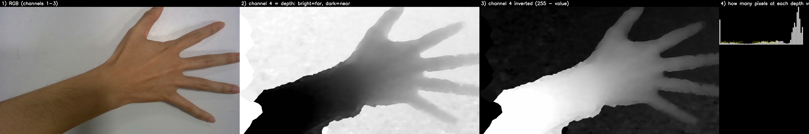
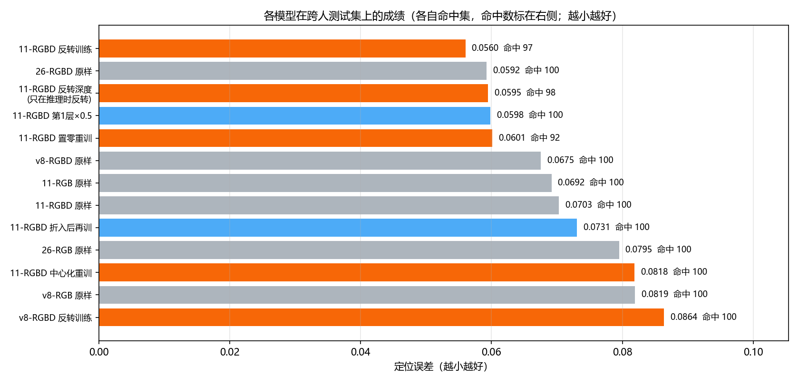
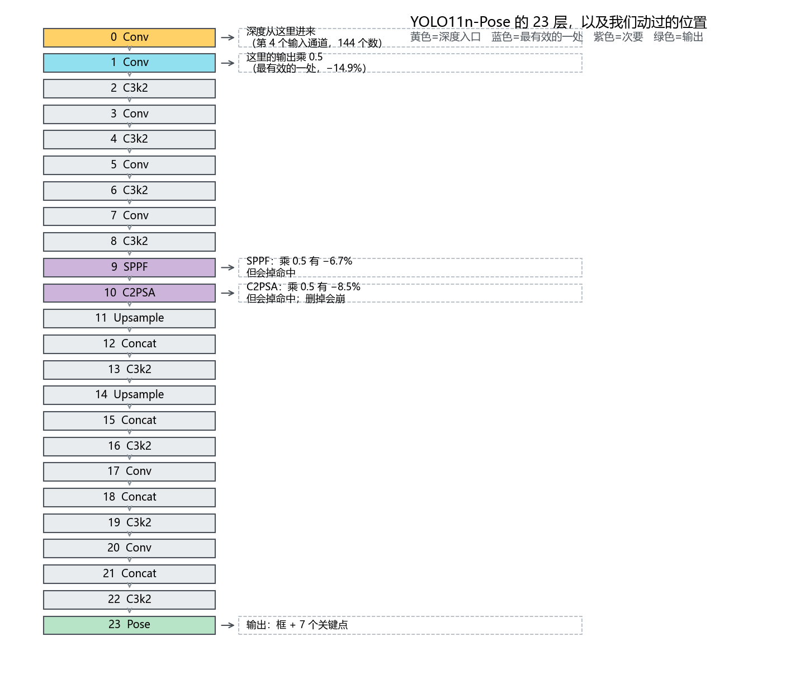
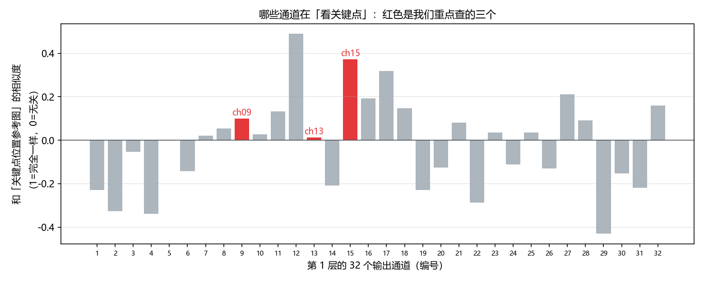
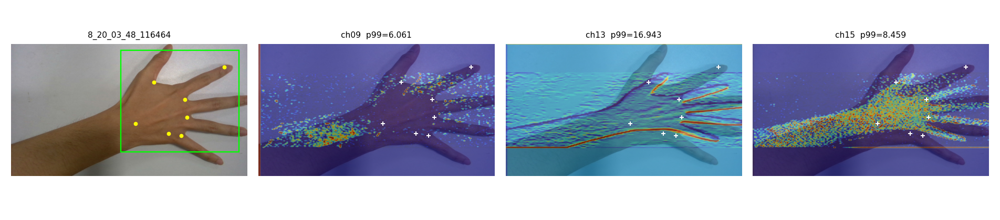
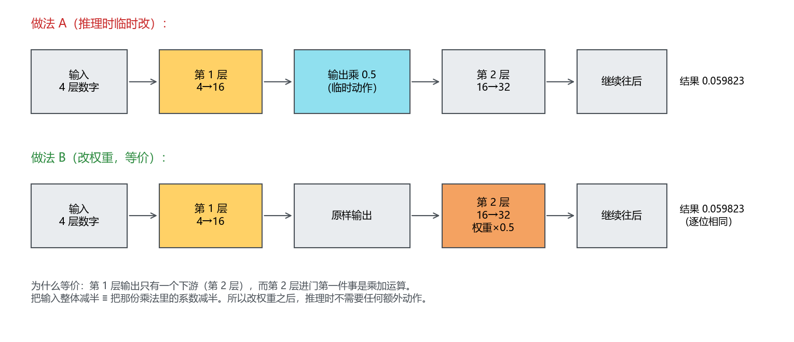
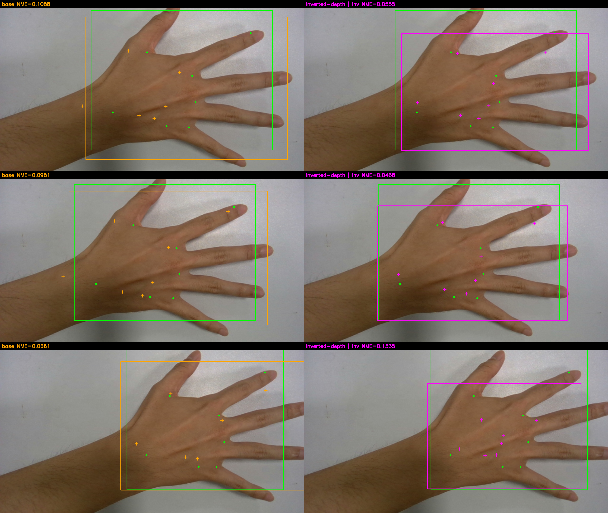
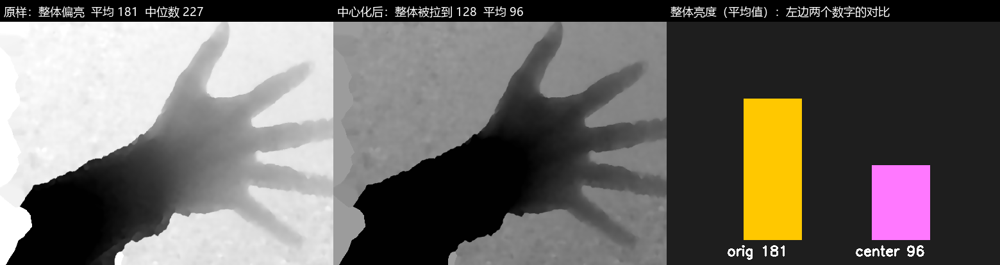
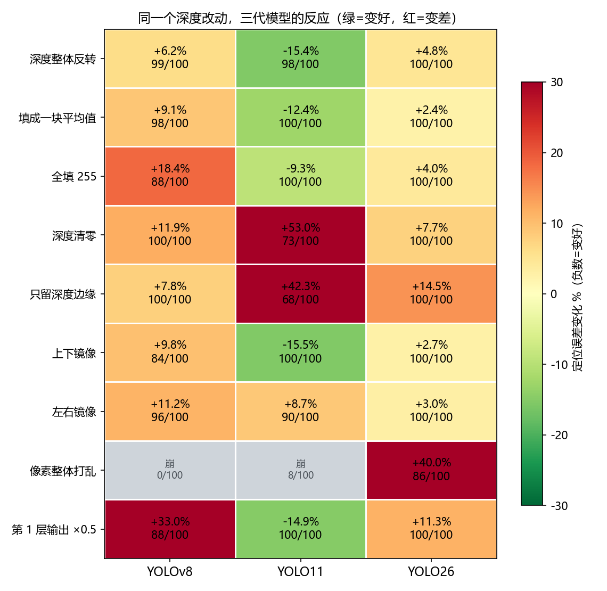

# 02-Multi-YOLO-RGB｜实验记录

> 记录"我们做了什么、看到什么、能得出什么"。
> 每个实验都配图（都在 `docs/` 下），每个数字都能在 `runs/` 里找到对应 CSV。
> 对应画布：`yolov8_rgbd_detection/YJJ_DrawIo/02-Multi-YOLO-RGB.drawio`

---

## 0. 先看名词表（后面全用这些词）

| 名词 | 一句话解释 |
|---|---|
| **一张图有 4 层数字** | 彩色图是红/绿/蓝 3 层；我们额外拼了第 4 层 = 深度 |
| **第 4 通道 / 深度** | 一张黑白图，**越亮 = 离相机越远**，越暗 = 越近 |
| **权重** | 网络里的一大堆数字，决定"它怎么听输入"。改权重 = 改它的偏好 |
| **层** | 网络是 23 个步骤串起来的（编号 0~23）；第 0 层是入口，第 23 层吐结果 |
| **第 0 层 / 第 1 层** | 第 0 层是"吃图像"的那层（4 层数字 → 16 个特征图），**深度只从这里进来**；第 1 层是 16 → 32 那层，本文大量干预发生在它的**输出**上 |
| **通道（第 1 层有 32 个）** | 第 1 层会吐 32 张"特征图"，每张负责找一种花纹 |
| **定位误差（NME）** | 预测的 7 个点离标准答案有多远，**越小越好**。0.07 → 0.06 在本项目里算明显进步 |
| **命中** | 预测框和标准框重合度 ≥0.5 才算"找到"。命中 97/100 = 有 3 张没找到目标 |
| **conf（门槛）** | 只保留"网络自己打分高于这个数"的框。本文统一 0.05（有一处专门讨论） |
| **4 通道改造** | 把官方 3 通道权重改造成吃 4 层数字；第 4 层的权重复制 RGB 三通道的平均 |
| **电平** | 这张深度图**整体有多亮** = 那堆数字的平均值 |
| **中心化** | 把每张图的整体亮度统一到 128，只保留"哪儿比哪儿亮" |
| **置零** | 把网络里"听深度"的那 144 个数全改成 0 |
| **折入** | 把"推理时临时乘 0.5"改写成"权重本身乘 0.5"，效果逐位相同 |
| **干预 / 消融** | 人为改掉某个东西，看结果怎么变 |

图 1、图 2 就是"第 4 通道"和"深度的权重"的实物：




---

## 1. 结论摘要

1. **六个模型**（跨人 100 张，全部 100/100 命中）：
   **26-RGBD 0.0592**、v8-RGBD 0.0675、11-RGB 0.0692、11-RGBD 0.0703、26-RGB 0.0795、v8-RGB 0.0819。
2. **深度对 v8、26 有用，对 11 没用**：v8 加上深度降 17.5%、**26 降 25.5%**、11 反而升 1.6%。
3. **11 的问题在第 1 层**：把第 1 层的输出整体乘 0.5，误差 0.0703 → 0.0598（−14.9%），命中不掉。
4. **这个操作能写进权重**：折进第 2 层后逐位复现 0.0598，推理时不需要额外动作。
5. **11 只看"深度整体有多亮"**：把深度换成一块均匀的 180（完全抹掉手的形状），比真实深度还好 12.2%；
   而填 1 或填 0 会崩（+52%~53%）。最优的 180 恰好等于训练时的平均水平 181。
6. **深度里其实有几何信息**：7 个标注点的深度差中位数 408mm，远大于噪声——但模型没用上。
7. **把深度整体反过来**，误差降 15.4%（98 命中）；只在推理时反转就行，不需要重训。
8. **训练时也用反转深度** → 公平口径 −22.4%（命中 97/100），是目前最好的结果，且可部署。
9. **改编码与改初始化都没能让模型学会用几何**：中心化重训后更差（+16.4%）；
   第 4 通道权重置零重训后虽然"填常数的优势"消失，但深度清零只影响 2.8%（原为 53%）
   → 它其实是**放弃依赖深度**，不是学会用几何。命中还从 100 掉到 92。
10. **v8 与 26 一致、11 相反**：11 上有效的改动（反转、填平均值、第 1 层 ×0.5），在 v8/26 上全部变差。
11. **"只把深度当亮度"是 11 特有**，不是 4 通道改造的普遍问题（4.19 有三代对照）。



---

## 2. 资源

### 2.1 权重

| 名称 | 起点 | 训练数据 | 轮数 | 文件 |
|---|---|---|---|---|
| `yolov8n_rgb_3ch` | `yolov8n-pose.pt` | hand/rgb（3 层） | 48 | `train_weight/yolov8n_rgb_3ch.pt` |
| `yolo11n_rgb_3ch` | `yolo11n-pose.pt` | hand/rgb | 83 | `train_weight/yolo11n_rgb_3ch.pt` |
| `yolo26n_rgb_3ch` | `yolo26n-pose.pt` | hand/rgb | 63 | `train_weight/yolo26n_rgb_3ch.pt` |
| `yolov8n_rgbd_4ch` | v8 的 4 通道改造版 | hand/rgbd（4 层） | 45 | `train_weight/yolov8n_rgbd_4ch.pt` |
| `yolo11n_rgbd_4ch` | 11 的 4 通道改造版 | hand/rgbd | 113 | `train_weight/yolo11n_rgbd_4ch.pt` |
| **`yolo26n_rgbd_4ch`** | **26 的 4 通道改造版** | hand/rgbd | **89** | `train_weight/yolo26n_rgbd_4ch.pt` |

指纹：`yolo11n_rgbd_4ch.pt` md5 `d5dfac630e304b941b106a8c31125523`；首层卷积 `(16, 4, 3, 3)`（吃 4 层）；7 个关键点；1 类 hand。
`yolo26n_rgbd_4ch.pt` md5 `228b38c28b93cec75e7d5be3c7b29fa4`，head 为 `Pose26`。
4 通道改造的完整规则与三代差异见 **4.18**。

### 2.2 数据

| 用途 | 路径 | 数量 |
|---|---|---|
| 训练 / 验证（同一个人） | `dataset/hand` | 52 / 11（另有 12 张同人测试） |
| 跨人测试（另一个人，正式评估） | `dataset/hand_common` | 100 |
| 反转深度训练 / 测试 | `dataset/hand_inv`、`dataset/hand_common_inv` | 75 / 100 |
| 中心化深度训练 / 测试 | `dataset/hand_center`、`dataset/hand_common_center` | 75 / 100 |

- 彩色图存 `.jpg`、4 层图存 `.png`，按去掉扩展名的名字配对。
- 跨人测试集做过关键点顺序统一（K0↔K1、K3↔K4），101/101 一致。

### 2.3 环境

| 项 | 值 |
|---|---|
| 解释器 | `MultiYoloRGB\.venv\Scripts\python.exe`（Python 3.13.5） |
| torch | 2.10.0+cu130 |
| GPU | RTX 4080 SUPER |
| ultralytics | 8.4.175（`.venv` 里的）；不用主仓根目录那份 8.3.176 |

### 2.4 评估口径（所有数字都在这个口径下）

```
conf = 0.05，输入尺寸 640
命中：预测框与标准框重合度 ≥ 0.50（取重合度最高的那个预测）
定位误差：7 个点的像素误差 ÷ 标准框对角线，只算标注可见的点，逐图平均再对 100 张平均
引用格式：0.070292（跨人 100 张，conf=0.05，命中 100/100）
```

`conf` 的取值约束（早期踩过坑）：

| conf | 命中 | 说明 |
|---|---|---|
| 0.001 | 100/100 | 11-RGBD 每图吐出 175.9 个框，误差读数虚高 16% |
| 0.005~0.05 | 100/100 | 框数约 1 个，两种选框规则结果一致 |
| 0.10 / 0.25 | 96 / 85 | 命中下降，误差数字变好看但不可比 |

---

## 3. 训练总账（把所有训练理顺）

一共训了 **11 次**（5 个基础 + 6 个后续）。每次都是同一套超参（120 轮上限、batch 4、640、早停 20、
增强几乎全关），差别只在 **起点** 和 **数据**。

| # | 训练名 | 起点 | 数据 | 实际轮数 | 产物 | 跨人结果（命中） |
|---|---|---|---|---|---|---|
| 1 | v8-RGB | `yolov8n-pose.pt` | hand/rgb | 48 | `yolov8n_rgb_3ch.pt` | 0.081902（100） |
| 2 | 11-RGB | `yolo11n-pose.pt` | hand/rgb | 83 | `yolo11n_rgb_3ch.pt` | 0.069164（100） |
| 3 | 26-RGB | `yolo26n-pose.pt` | hand/rgb | 63 | `yolo26n_rgb_3ch.pt` | 0.079497（100） |
| 4 | v8-RGBD | v8 4 层改造版 | hand/rgbd | 45 | `yolov8n_rgbd_4ch.pt` | 0.067529（100） |
| 5 | **11-RGBD（主模型）** | 11 4 层改造版 | hand/rgbd | 113 | `yolo11n_rgbd_4ch.pt` | **0.070292（100）** |
| 6 | 11-RGBD 折入后再训 | 已训练权重折入 | hand/rgbd | 26 | `yolo11n_rgbd_4ch_L1x0.5_retrain.pt` | 0.073084（100） |
| 7 | 11-RGBD 干净折入→训 | 干净权重折入 | hand/rgbd | 64 | `yolo11n_rgbd_4ch_cleanL1x0.5.pt` | 只命中 41（打分塌了） |
| 8 | **11-RGBD 反转训练** | 干净 11 4 层版 | hand_inv | 70 | `yolo11n_rgbd_4ch_inv.pt` | **0.056028（97）** |
| 9 | v8-RGBD 反转训练 | 干净 v8 4 层版 | hand_inv | 69 | `yolov8n_rgbd_4ch_inv.pt` | 0.086354（100） |
| 10 | 11-RGBD 中心化重训 | 干净 11 4 层版 | hand_center | 57 | `yolo11n_rgbd_4ch_center.pt` | 0.081842（100） |
| 11 | 11-RGBD 置零重训 | 第 4 通道权重置零 | hand/rgbd | 69 | `yolo11n_rgbd_4ch_w4zero.pt` | 0.060118（92） |
| 12 | **26-RGBD** | 26 4 通道改造版 | hand/rgbd | 89 | `yolo26n_rgbd_4ch.pt` | **0.059238（100）** |

**读这张表要注意三件事：**

1. **"实际轮数"差异很大**（26~113），因为早停。轮数少不代表训练差，而是它很早就达到验证集上限。
2. **早期的验证集（11 张、同一个人）分辨不出好坏**：第 8 次和第 11 次训练的验证分数都是 0.995，
   但跨人结果差很多。**选模型必须看跨人测试。**
3. 第 7 次（干净折入→训）不可用：打分整体塌了一个数量级，命中只剩 41/100。

---

## 4. 实验记录

每一段的格式：**想做什么 → 怎么做的 → 结果 → 结论（人话）**。

这一章共 19 段，按"我们当时被什么问题卡住"排的，可以分五组读：

| 组 | 段落 | 这一段在解决什么 |
|---|---|---|
| ① 摸清底数 | 4.1 ~ 4.4 | 五个模型谁好谁坏、口径怎么定、框和点的关系 |
| ② 定位问题层 | 4.5 ~ 4.7 | 删层不行 → 改成"把某层输出乘系数" → 扫出最优系数 |
| ③ 定位到通道 | 4.8 ~ 4.9 | 32 个通道里是哪几个在起作用、它们各自在提供什么 |
| ④ 变成可部署的东西 | 4.10 ~ 4.11 | 把"乘 0.5"折进权重；以及折入后再训为什么不行 |
| ⑤ 深度到底被用成了什么 | 4.12 ~ 4.19 | 31 种改动 → 方向 → 训练期反转 → 几何信息有多少 → 改编码 vs 改初始化 → 三代改造与对比 |

其中 4.19 是全章的收尾对照（三代横向），也是第三阶段的起点。

### 4.1 第一轮：初版几个权重放一起比（旧口径，后被推翻）

**想做什么**：同一套数据、同一套超参，只换起点，看谁在跨人测试上最准。

**怎么做的**：训练 5 个模型（表 3 的 1~5 号），在 100 张跨人图上算定位误差。

**结果**（conf=0.001 的旧口径）：

| 模型 | 命中 | 定位误差 |
|---|---|---|
| v8-RGB | 101/101 | 0.081902 |
| 11-RGB | 100/101 | 0.069727 |
| 26-RGB | 101/101 | 0.109463 |
| 11-RGBD | — | 0.083978 |

**当时的结论**：11 最好、26 最差、11-RGBD 打不过 8-RGB。
**后来被推翻**（见 4.2）：这一轮用的是 conf=0.001，读数被噪声框带偏。

### 4.2 conf 扫描：发现"每图 175 个框"

**想做什么**：为什么 11-RGBD 的分数这么差？先怀疑框太多。

**怎么做的**：把 conf 从 0.001 扫到 0.25，看每张图输出多少框、误差怎么变。

**结果**：

| 模型 | conf=0.001 框数/图 | conf=0.05 框数/图 | 误差 0.001 → 0.05 |
|---|---|---|---|
| 11-RGBD | **175.92** | 1.00 | 0.0840 → **0.0703**（−16.3%） |
| 26-RGB | 7.91 | 1.01 | 0.1095 → **0.0795**（−27.4%） |
| 其余三个 | 1.1~1.4 | ~1.0 | 几乎不变 |

**结论（人话）**：`conf=0.001` 会让网络把一堆"我觉得有点像"的框都吐出来，噪声把读数抬高了。
口径改成 **conf=0.05** 之后，4.1 的排名作废，重新排。

### 4.3 正式排名（口径统一后）

**结果**（100 张跨人图，全部 100/100 命中）：

| 模型 | 定位误差 | 和自家 3 通道比 |
|---|---|---|
| v8-RGBD | **0.067529** | **加深度降 17.5%** |
| 11-RGB | 0.069164 | — |
| 11-RGBD | 0.070292 | 加深度反而升 1.6% |
| 26-RGB | 0.079497 | — |
| v8-RGB | 0.081902 | — |

**结论（人话）**：
- 26 不是最差，它比 v8-RGB 好；
- **真正的问题不是"11 打不过 v8 的 RGB"（0.0703 已经好过 0.0819），而是"11 有深度却没用上"**。

### 4.4 是不是选框规则的问题

**想做什么**：框和点是同一次推理给出的，会不会是框选错了导致点跟着错。

**怎么做的**：每张图把所有框逐个和标准框比，看"框重合度"和"点误差"的关系。

**结果**：图内相关系数 −0.70（11-RGBD）、−0.89（v8-RGBD），负相关 100%/96% 的图。

**结论（人话）**：框越好、点越准 → **"取重合度最大的框"这条规则是对的**，不用改。
11-RGBD 当时还有 17.2% 的"理想上限"空间，说明它的框质量本身很分散，指向"特征不稳"。

### 4.5 想直接删层 → 失败

**想做什么**：如果某层有问题，能不能直接拿掉。

**怎么做的**：把某一层替换成"原样返回输入"，其余不动。



**结果**：
- 19 层里只有 6/8/9/10 这几层能真替换（其余层输入输出尺寸不同，换掉就断链，`skipped.csv` 39 条）；
- 替换后检出崩：第 6 层命中 0/100、第 8 层 28、第 9 层 51、第 10 层 24；
- 把 C2PSA（第 10 层）拿掉：11-RGBD 命中 100→58，11-RGB 100→24。

按"各自命中的图"算误差，崩掉一半后误差反而好看（这是幸存者偏差）。
按"两边都命中"的图重算：11-RGBD 只 −2.7%（基本没变），11-RGB 反而恶化 +69%。

**结论（人话）**：**删层不可行**，一删就找不到目标；C2PSA 是"检测的承重墙"，不能拆。

### 4.6 换个思路：不删层，只把某层输出乘系数

**想做什么**：想调低某一层的影响，但不想破坏结构。

**怎么做的**：把某一层的输出乘一个系数（0.5 = 调暗一半），继续往后传。
不改权重、不删结构，只改中间结果。

**结果**（11-RGBD，100 张）：

| 动的层 | 误差变化 | 命中 |
|---|---|---|
| **第 1 层 ×0.5** | **−14.9%**（0.0703 → 0.0598） | 100/100 |
| 第 9 层 ×0.5（SPPF） | −6.7% | 97/100 |
| 第 10 层 ×0.5（C2PSA） | −8.5% | 95/100 |
| 第 1+9+10 层一起 | −18.7%（0.0569） | 93/100 |

五个模型统一做第 1 层 ×0.5：

| 模型 | 原样 | ×0.5 | 变化 |
|---|---|---|---|
| **11-RGBD** | 0.070292 | **0.059823** | **−14.9%** |
| 11-RGB | 0.069164 | 0.062656 | −9.4% |
| 26-RGB | 0.079497 | 0.069943 | −12.0% |
| v8-RGB | 0.081902 | 0.076914 | −6.1% |
| **v8-RGBD** | 0.067529 | 0.089841 | **+36.7%（更差）** |

**结论（人话）**：
- **第 1 层是最有效的一处**，而且命中不掉；
- 9/10 层也有收益，但会掉命中，不是主线；
- **v8-RGBD 反向恶化** → 这不是通用技巧，跟模型本身有关。

### 4.7 调多少最合适：剂量曲线

**想做什么**：第 1 层乘 0.5 是拍脑袋的，得扫一遍。

**怎么做的**：系数从 1.00 降到 0.25，每档跑 100 张。


**结果**（公平口径 97 张）：

| 系数 | 0.25 | 0.40 | 0.45 | 0.48 | 0.50 | 0.60 | 0.75 | 0.90 | 1.00 |
|---|---|---|---|---|---|---|---|---|---|
| 误差 | 崩（12 张） | 0.0599 | **0.0589** | 0.0589 | 0.0593 | 0.0615 | 0.0651 | 0.0676 | 0.0694 |
| 命中 | 12 | 97 | 99 | 99 | 100 | 100 | 100 | 100 | 100 |

**结论（人话）**：曲线是**单调的**——越暗越好，直到 0.45；再暗（0.40）开始回升且漏图，0.25 直接崩。
0.45 最优但命中 99/100；**0.50 是"100 张全命中"里最好的**，所以后面统一用 0.50。

### 4.8 第 1 层里是哪些通道

**想做什么**：第 1 层吐出 32 张特征图，是哪几张在起作用。

**怎么做的**：32 个通道分 4 组（每组 8 个），先按组恢复，再逐个通道恢复。



**结果**（其他 24 个通道保持 0.5，只把一组恢复成 1.0）：

| 恢复哪组 | 误差 |
|---|---|
| 都不恢复（全 0.5） | 0.0598 |
| 第 1 组 | 0.0595（没影响） |
| **第 2 组（ch09~ch16）** | **0.0685（收益基本没了）** |
| 第 3 组 | 0.0636 |
| 第 4 组 | 0.0642 |

第 2 组里逐个恢复：

| 恢复哪个通道 | 误差 | 说明 |
|---|---|---|
| ch09 | 0.0697（+17.6%） | 恢复它 → 变差 ⇒ 削弱它有益 |
| ch15 | 0.0683（+14.2%） | 同上 |
| ch13 | 0.0573（−4.2%） | 恢复它 → 略好 |

**结论（人话）**：收益集中在第 2 组里的 ch09 和 ch15；ch13 有一点反向效果，但很小。

### 4.9 这三个通道各自在干什么

**想做什么**：把"削弱有用"翻译成"这个通道到底在提供什么"。

**怎么做的**：把通道的输出当成一张灰度图，做两种破坏：

- **打乱**：像素位置随机重排（亮度分布不变，"哪儿亮"没了）
- **涂平**：整张换成一个平均值（只剩"有多亮"）
- 另外对一个无关通道做同样的打乱，作为噪声水平



**结果**（100 张，对比同一基线）：

| 干预 | 误差变化 | 变好 / 变差 |
|---|---|---|
| 打乱 ch01（噪声水平） | −0.52% | 51 / 49 |
| 打乱 ch09 | −0.72% | 54 / 46 |
| **涂平 ch09** | **−1.49%** | **89 / 11** |
| 打乱 ch15 | **+7.80%** | 5 / 95 |
| **涂平 ch15** | **+5.83%** | 10 / 90 |
| 打乱 ch13 | +0.52% | 38 / 61 |
| 涂平 ch13 | −1.45% | 42 / 57 |

**结论（人话）**：
- **ch09 是"一块一直亮着的底色"**：图案没用（打乱和噪声一样），但整体太亮在干扰（涂平就变好）。
- **ch15 是"有用的画但过曝"**：图案一动就坏（95% 的图变差），同时幅度也偏大。
- **ch13 是噪声级**：两个方向都在一半一半，不单独下结论。
- 单通道最多解释 1.5%，整层是 14.9% → **收益主要来自"整层一起调暗"，不是某两个通道**。

### 4.10 把这个操作写进权重

**想做什么**：乘 0.5 是推理时做的，部署时没法用。

**怎么做的**：第 1 层的输出只喂给第 2 层，而第 2 层进门第一件事就是乘加运算。
所以把第 2 层那份乘法里的系数减半，等价于把第 1 层输出减半。



**结果**：

| 做法 | 误差 | 命中 |
|---|---|---|
| 原权重 | 0.070292 | 100 |
| 推理时临时乘 0.5 | 0.059823 | 100 |
| **权重折入后** | **0.059823** | 100 |

逐点误差（K0~K6）也完全相同。产物 `yolo11n_rgbd_4ch_L1x0.5.pt`（源权重未改动）。

**结论（人话）**：折入是**逐位等价**的，不需要重新训练，部署时也不用改推理代码。

### 4.11 折入之后再训练（两个起点）

**想做什么**：如果拿折入后的权重继续训练，会更好还是更坏。

**结果**：

| 起点 | 轮数 | 命中 | 误差 |
|---|---|---|---|
| 已训练权重折入后再训 | 26 | 100 | 0.073084（更差） |
| 干净权重折入后再训 | 64 | **41** | 打分塌了，不可用 |

**结论（人话）**：**"先折入再训练"不可用**（会毁掉检出）；折入只能是"训练完之后的一步"。

### 4.12 深度到底被用成了什么：31 种改动

**想做什么**：把能想到的输入改动一次跑完，看它对什么敏感。

**怎么做的**：只改第 4 层数字，权重和结构都不动，同一张图做 31 种改法。


**结果**（100 张，负数为变好）：

| 类型 | 例子 | 变化 |
|---|---|---|
| **有效** | 上下镜像、整体反转、整体 +102、填平均值、提亮 | **−9% ~ −15.5%** |
| 无效（±2%） | 模糊、只留 4 个等级、错位 16 像素、加噪声 | 看不出差别 |
| **有害** | 填 0、填 1、只留边缘、压暗、左右镜像 | **+8.7% ~ +53%** |
| 对照 | 改颜色（+51 / 反转） | −1.3% / 崩 |

每一种改动**改完的第 4 通道长什么样**，见 `docs/fig-03-depth-variants.png`（31 格图，
每格左上角标了短名与实测误差）；完整数据在 `runs/depth_battery/yolo11n_rgbd_4ch/summary.csv`。

**结论（人话）**：
- 它对**整体高低**敏感，**对细节不敏感**（模糊、降精度都没影响）；
- 改动只发生在第 4 层有效（改颜色几乎没用）；
- **同样的改法在 v8 上方向相反**（见 4.15）。

### 4.13 到底是"手变亮"还是"背景变暗"在起作用

**想做什么**：4.12 里"手涂亮 / 背景涂黑"是同时改的，分不清哪一边有效。

**怎么做的**：三种只改一边的做法（用标注框分出手和背景）。

**结果**（100 张）：

| 做法 | 手的值 | 背景的值 | 变化 | 命中 |
|---|---|---|---|---|
| 原样 | 162 | 203 | — | 100 |
| **只把手抬高** | 254 | 203 | **−14.3%** | 100 |
| 只把背景压低 | 162 | 1 | **+11.4%（更差）** | 100 |
| **手和背景对调（差不变，只翻方向）** | 203 | 162 | **−12.9%** | 100 |
| 手涂 255 / 背景涂 1 | 255 | 1 | −6.0% | 100 |
| 反过来涂 | 1 | 255 | +36.5% | 83 |

**结论（人话）**：
- 起作用的是**"手要比背景数值大"**，不是"背景变暗"；
- **保持高低差不变、只把方向翻过来**也能降 12.9% → **方向确实反了**；
- 真实数据里手是"近=数值小"，所以网络一直在跟数据较劲。

### 4.14 训练时也用反转深度

**想做什么**：只在推理时反转是"临时动作"，能不能把训练也统一成反转，做成真正的预处理规范。

**怎么做的**：生成反转版数据集（第 4 层取 255−原值），从头训练一个模型，再和原模型在**同一批图**上比。



**结果**（四个条件都命中的 91 张）：

| 条件 | 命中 | 误差 | 相对原模型 |
|---|---|---|---|
| 原模型 @ 原始深度 | 100 | 0.069417 | — |
| 原模型 @ 反转深度（只推理反转） | 98 | 0.058822 | −15.3% |
| **反转训练的模型 @ 反转深度** | **97** | **0.053841** | **−22.4%** |
| 反转训练的模型 @ 原始深度（交叉） | 92 | 0.063389 | −8.7% |

**结论（人话）**：
- 训练时也反转 → **−22.4%**，比只在推理时反转（−15.3%）更好：网络能学会这个约定；
- 可部署：推理时不做任何额外动作，只改数据预处理；
- **代价：命中 100 → 97**，论文里必须一起报。

### 4.15 v8 做同样的反转训练

**结果**：v8 在反转数据上训练 69 轮，跨人误差 **0.086354**（100/100），比它自己原样 0.067529 **差 27.9%**。

**结论（人话）**：反转深度是 **11 特有**的，不能当通用预处理。v8 需要原始的连续深度。

### 4.16 深度里的几何信息有多少 / 电平有多重要

**想做什么**：如果深度里有能区分 7 个点的信息，那"网络没用上"才是真问题。

**怎么做的**：① 取 7 个标注点位置的深度值，看它们差多少；② 把整张深度换成固定常数，看误差怎么变。

**结果 ①：7 个点的深度差**

| 项 | 值 |
|---|---|
| 每张图 7 点最大差的中位数 | 138 个数值 ≈ **408 mm** |
| 样例（mm） | 1593 / 1702 / 1564 / **1333** / 1572 / 1510 / 1581 |

→ **信息确实存在**（差几百毫米，远大于测量噪声）。

**结果 ②：换成固定常数**



| 填的数 | 1 | 40 | 60 | 100 | 140 | **180** | 220 | 255 | 真实深度 |
|---|---|---|---|---|---|---|---|---|---|
| 误差变化 | +52.3% | +33.7% | +20.3% | −1.7% | −11.4% | **−12.2%** | −10.9% | −9.3% | 0 |

**结论（人话）**：
- **有门槛**：填的比 100 低就开始变差，比 60 低直接崩；
- **最优是 180**，而训练集第 4 层的平均正好是 181 → 网络要的是"训练时那个亮度水平"；
- 填一块均匀的 180 比真实深度还好 12.2% → **真实深度里的起伏是干扰**。

### 4.17 想办法让它学会几何：改编码 vs 改初始化

**想做什么**：既然它只看电平，那能不能纠正。

**判据（事先定好）**：原模型下"填 180"比真实深度好 12.2%；如果改对了，真实深度应不再输给常数。

**做法 A：改编码（中心化）**

先分清两件容易混的事：

| 说法 | 具体做法 | 图片会变成什么样 |
|---|---|---|
| **填常数**（4.12 的 A09/A10/A11） | 所有像素都改成同一个数 | 整张变一块纯灰/纯白，手的形状没了 |
| **中心化**（本节） | 整张图**统一加/减一个数**（平移），只把中位数挪到 128 | **手的形状完好**，只是整体亮度被拉平 |

所以中心化**没有**抹掉"手比背景暗"这件事，只是让"整体多亮"对所有图都一样（图 4 的左/右对比）。
中心化后每张图的中位数都是 128，平均约 90~100（因为背景像素占多数）。

**设计逻辑**：原模型只会看"整体亮度"这个维度（4.16：填常数比真实深度好 12.2%）。
把这个维度拉平之后，它就没有东西可看了，应该变差——如果它不会转而去看起伏，那就说明改编码无效。

把中心化后的数据重训：

| 输入 | 误差 | 相对真实 |
|---|---|---|
| 真实（中心化）深度 | 0.081842 | — |
| 填 180 | 0.077355 | **−5.5%** |

→ **失败**，两处证据：
1. 比原模型（0.0703）差 16.4%，甚至比 3 通道模型（0.0692）还差
   → 中心化之后第 4 层不但没帮忙，还变成了噪声；
2. 重训后**依然"填常数更好"**（好 5.5%）→ 它没有学会看起伏，
   只是学会了"忽略深度这条通道"。

推测：把唯一会用的一维（整体亮度）钉死，等于废掉这条线索，而它又学不会另一种用法。

**做法 B：改初始化（第 4 通道权重置零）**

把网络里"听深度"的 144 个数清零，让它在训练中自己长出来。重训 69 轮。

| 输入 | 命中 | 误差（共同 89 张） | 相对真实 |
|---|---|---|---|
| **真实深度** | 92 | **0.059770** | — |
| 填 100 | 96 | 0.058733 | −2.3% |
| 填 180 | 90 | 0.060662 | +0.9% |
| 填 255 | 89 | 0.063047 | +4.9% |

与原模型在共同 92 张上比：原模型 0.068334 → 置零重训 0.060118，**−12.0%**。

→ **判据基本达成**：真实深度不再输给常数（差 2.3%，噪声范围），而"填 180/255"反而更差。
原模型"常数赢 12.2%"的模式消失了。**代价：命中 100 → 92。**

**三个初始化横向对照**：

| 初始化 | 真实深度 | 最佳常数 | 常数赢多少 | 命中 |
|---|---|---|---|---|
| 原样（第 4 通道 = RGB 均值） | 0.070292 | 0.061730 | **12.2%** | 100 |
| 中心化重训 | 0.081842 | 0.077355 | 5.5% | 100 |
| **第 4 通道权重置零重训** | **0.060118** | 0.058733 | **2.3%** | **92** |

**做法 C：把整套 30 项测试跑到置零模型上（关键补测）**

上面只看了"真实 vs 填常数"。要判断它是否**真的在用几何**，得看它对"破坏结构"是否敏感：
如果它靠结构，那"打乱像素""只留边缘""清零"都该让它变差。

| 改动 | 原模型（100 命中） | **置零重训模型（92 命中）** |
|---|---|---|
| 深度整体反转 | **−15.38%**（98） | **−0.76%**（91） |
| 像素整体打乱 | −30.0%（**只剩 8 命中**） | **+1.12%**（92） |
| 有效区填平均值 | −12.45%（100） | +1.06%（91） |
| 数值 +102 | −13.01%（100） | +3.07%（89） |
| 数值 −51 | +20.73%（99） | −1.73%（93） |
| 上下镜像 | −15.46%（100） | −1.13%（95） |
| 左右镜像 | +8.71%（90） | +1.48%（95） |
| **深度清零** | **+53.01%**（73） | **−2.83%**（97） |
| 只留边缘 | +42.28%（68） | −3.26%（96） |
| 换成黑白图 | +4.69%（100） | −1.07%（93） |

**这张表推翻了一个结论**：置零重训之后，**所有深度改动的影响都缩到 ±3% 以内**，
连"深度清零"都只让误差变动 −2.8%（甚至略好），而原模型上是 +53%。

→ 所以置零重训**不是"学会了用几何"，而是"基本不用深度了"**。
它 0.060118 的成绩主要来自"去掉了一个有害通道"，不是"利用了一个有用通道"。
"常数赢 12.2% 消失"这个现象，也因此不能当作"它开始用结构"的证据
（真正的解释是：它对深度整体不再敏感，所以真实和常数都差不多）。

**结论（人话，已修正）**：
- 改深度编码（中心化）没用：网络不会转而看起伏，反而整体更差；
- 改第 4 通道初始化（置零）也**不是**让它学会用几何，而是让它**放弃依赖深度**；
- **到目前为止，我们没有任何一个实验让模型真正用上深度的几何信息**；
- 目前所有收益都来自"削弱/纠正这条错误通路"（反转、调暗、置零），而不是"让几何被用上"。
- 要真正让几何被用上，需要改结构（多路深度输入、深度分支）或换更多主体数据，本文未做。

---

### 4.18 三代如何改造成 4 通道（含 YOLO26）

**想做什么**：官方权重只吃 3 层数字。要喂 4 层，必须先改造第一层，让三代都能吃同一份 4 通道数据。

**改造规则（三代统一，脚本 `build_rgbd_pose_weights.py`）**

1. 第一层卷积的输入通道 3 → 4；
2. 新增的第 4 个输入通道权重 = 前三个通道权重的**逐位置平均**；
3. 其余所有层、所有参数原样复制；
4. 保存后必须校验 `model.model[0].conv.weight.shape[1] == 4`。

**为什么用"平均值"初始化**：只有第 1 层需要改（后面各层的输入都是特征图，不是图像）。
取平均值是唯一不引入新偏向的选择——它让第 4 通道在**起点上**与"亮度"完全等价。
这一点是后面 4.16、4.17 发现问题的重要背景。

**三代各自的情况**

| 模型 | 官方权重 | 模型类 / head | 层数 | 改造产物 |
|---|---|---|---|---|
| YOLOv8n-Pose | `yolov8n-pose.pt` | `Pose` | — | 主仓 `YJJ_Pose_Scripts/weights/4ch/yolov8n-pose_4ch.pt` |
| YOLO11n-Pose | `yolo11n-pose.pt` | `Pose` | — | `yolo11_4ch/yolo11n-pose_4ch.pt`（md5 `7a251266…`） |
| **YOLO26n-Pose** | `yolo26n-pose.pt` | **`Pose26`** | **363** | `yolo26_4ch/yolo26n-pose_4ch.pt` |

**YOLO26 为什么之前被跳过、这次才补**

- 26 的 head 是 `Pose26`（不是 `Pose`），层数 363，与 8/11 不同；
- 早期只验证了 8/11 的改造，26 因为在 3 通道对比里排最后（0.0795）被判定"不必浪费时间"，
  所以第二阶段前面的深度实验只覆盖 v8 和 11；
- 这次补做的验证输出（原文）：

```
23  [16, 19, 22]  1  1416840  ultralytics.nn.modules.head.Pose26  [1, [17, 3], 1, True, [64, 128, 256]]
YOLO26n-pose summary: 363 layers, 3,679,608 parameters, 10.5 GFLOPs
✅ 第一层输入通道 == 4 校验通过
✅ 已生成 4 通道权重: yolo26_4ch\yolo26n-pose_4ch.pt
```

- 结论：**同一个改造脚本可直接处理 26**（脚本从权重自带的 yaml 里读 head 类，无需改代码）。

**改造只解决"能吃了"，不解决"会不会用"**。三代训练后的行为差异见 4.19。

---

### 4.19 三代 4 通道对比（第二阶段收尾）

**想做什么**：让三代在同一份数据、同一口径下排一次，回答"深度对每一代到底有没有用"。
这一段同时是 4.16、4.17 的对照组。

**怎么做的**：三代都用 4.18 的产物作起点，同一套超参、同一份 `hand/rgbd` 数据训练
（轮数见第 3 节），再在同一份 100 张跨人图上评测。

**结果一：三代 3 通道 vs 4 通道**

| 模型 | 3 通道 | 4 通道 | 深度带来的变化 | 命中 |
|---|---|---|---|---|
| YOLOv8 | 0.081902 | 0.067529 | **−17.6%** | 100 → 100 |
| YOLO11 | 0.069164 | 0.070292 | **+1.6%（没用上）** | 100 → 100 |
| **YOLO26** | 0.079497 | **0.059238** | **−25.5%（收益最大）** | 100 → 100 |

4 通道排名：**26（0.0592）> v8（0.0675）> 11（0.0703）**，三者都是 100/100 命中。

**结果二：同一个深度改动，三代的反应方向**（三份 34 项矩阵，同一口径、同一套条件）



| 改动 | v8-RGBD | 11-RGBD | 26-RGBD |
|---|---|---|---|
| 深度整体反转 | +6.25%（99） | **−15.38%**（98） | +4.81%（100） |
| 填成一块平均值 | +9.08%（98） | **−12.45%**（100） | +2.40%（100） |
| 全填 255 | +18.43%（88） | **−9.29%**（100） | +4.04%（100） |
| 深度清零 | +11.93%（100） | **+53.01%**（73） | +7.73%（100） |
| 只留深度边缘 | +7.80%（100） | **+42.28%**（68） | +14.51%（100） |
| 上下镜像 | +9.75%（84） | **−15.46%**（100） | +2.70%（100） |
| 左右镜像 | +11.23%（96） | +8.71%（90） | +2.95%（100） |
| 像素整体打乱 | **崩（0/100）** | **崩（8/100）** | **+40.03%**（86） |
| 第 1 层输出 ×0.5 | +33.04%（88） | **−14.89%**（100） | +11.28%（100） |

命中 <60 的格子视为"检出崩掉"，其误差不可与 100 命中的条件并列；
60~99 的格子照常给数值、同时标出命中数。

**结论（人话，这一节修正了 4.16/4.17 的说法）**：

1. **深度对 v8 和 26 都有用，唯独 11 用不上**（−17.6% / −25.5% / +1.6%）。
2. **v8 最"护食"**：9 项改动里能比的 8 项**全部变差**（+6.2% ~ +33.0%），打乱直接 0 命中
   → 它把深度用得很紧，碰一下就掉。
3. **26 与 v8 同方向但幅度小**：8 项里 7 项变差（+2.4% ~ +14.5%），打乱 +40.0%
   → 同样依赖结构，只是没那么脆。
4. **11 是唯一的异类**：9 项里有 5 项让它**变好**（反转 −15.4%、填平均值 −12.4%、
   全填 255 −9.3%、上下镜像 −15.5%、第 1 层 ×0.5 −14.9%）。
5. **26 的原始 4 通道模型（0.0592）已经好过 11 的所有改进手段**，只有"11 反转训练"
   （0.0560）还能略胜它——这一点对"该用哪一代"的判断很关键。
6. 因此 **4.16/4.17 里"网络只把深度当整体亮度"这个结论必须收窄为"YOLO11 特有"**，
   不能再说成"4 通道改造的普遍问题"。
7. 论文里的意义：11 的异常现在有 v8、26 两个忠实对照组，**比单独讲 11 强得多**。

**第二阶段收尾清单**

| 项 | 状态 |
|---|---|
| 六个权重（v8/11/26 的 RGB 与 RGBD 各一）训练与评测 | 完成 |
| 三代 RGBD 全部 100/100 命中、同一口径 | 完成 |
| 三代 × 34 项深度矩阵（`runs/depth_battery/*/summary.csv`） | 完成（v8/26 各 34 项，11 为 31 项，缺的 3 项是 3 个常数变体） |
| 第 1 层剂量曲线、通道归因、折入、反转训练、中心化、置零 | 完成（4.6~4.17） |
| 需要排除的项 | `depth_shuffle` 在 v8/11 上崩掉（0/8 命中），其误差不进任何对比 |

---

## 5. 现在能说什么、不能说什么

**能说（每条都有对照数据）**

| 结论 | 证据 |
|---|---|
| 深度对 v8 有用、对 11 无用 | v8 −17.5%、11 +1.6%（4.3） |
| **深度对 26 也用，且收益最大** | 26 从 0.0795 → 0.0592，**−25.5%**，命中不掉（4.19） |
| **"深度被当亮度"是 11 特有** | 只有 11"填平均值/反转/调暗第1层"会变好；v8 与 26 三项全部变差（4.19） |
| 11 的问题在第 1 层 | 整层 ×0.5 → −14.9%，且能折进权重（4.6、4.10） |
| 11 只看深度的整体亮度，不看细节 | 填常数 180 比真实深度好 12.2%；模糊/降精度 ±2%（4.16） |
| 深度信息存在但没被用 | 7 点深度差 408mm（4.16） |
| 手在深度里"应该更亮" | 只抬手 −14.3%、只翻方向 −12.9%、反向涂 +36.5%（4.13） |
| 训练期反转深度可部署且最好 | 公平口径 −22.4%，命中 97（4.14） |
| 反转是 11 特有 | v8 反转训练 +27.9%（4.15） |
| 改初始化能让模型**不再依赖**深度 | 深度清零的影响从 +53.0% 缩到 −2.8%（4.17 做法 C） |

**不能说**

| 不能说 | 为什么 |
|---|---|
| "11 没吃到深度是因为分辨率不够" | 7 点差 408mm，信息是有的（4.16） |
| "反转有效是因为亮度探测器方向反了" | 权重放大 ×2 后反转收益反而变小（⑯ 权重实验） |
| "先折入再训练也行" | 实测毁掉检出（4.11） |
| "这个规律对所有模型都成立" | v8 全部相反（4.15） |
| "上下镜像为什么有效" | 未解释 |
| "为什么反转（整体偏暗）也有效" | 与"电平门槛"矛盾，未解释 |
| **"置零重训让模型学会了用几何"** | 置零后所有深度改动影响都 <3%，连清零都只 −2.8%（4.17 做法 C） |
| **"所有模型都只把深度当亮度"** | 只有 11 如此；v8 与 26 填平均值都变差、打乱都崩（4.19） |
| **"我们已经让深度被正常利用"** | 没有任何一个实验做到；现有收益都来自"削弱错误通路" |

---

## 6. 适用条件与边界

1. 全部结论只在一个受试者的训练集（52 张）与**另一个受试者的 100 张测试图**上验证过；
   涉及模型的地方覆盖 **YOLOv8n / YOLO11n / YOLO26n** 三代（4.19），但机理类实验（4.5~4.17）只在 YOLO11n 上做过。
2. 只跑了一个随机种子，没有重复训练方差。
3. 除了 4.10、4.14、4.15、4.17、4.18 的产物，其余都是**推理期干预**（权重没改）。
4. 4.12 里"像素打乱"在 11 上只剩 8/100 命中、在 v8 上是 0/100，其误差不可与其他条件并列。
5. 早期 `conf=0.001` 下的结论（4.1）已作废，只在文档里留作对照。
6. 4.13 的"用标注框"版本属于用了标准答案，只能当上限参考。
7. 4.17 的置零重训命中掉到 92/100，不能只看误差。
8. 4.19 里 26 的 4 通道只训了一次，−25.5% 未做重复训练。

---

## 7. 怎么复现

| 想重跑什么 | 脚本 | 产物 |
|---|---|---|
| **把官方权重改造成 4 通道** | 主仓 `YJJ_Pose_Scripts/02_model/build_rgbd_pose_weights.py` | `yolo11_4ch/`、`yolo26_4ch/`、主仓 `weights/4ch/` |
| 五个模型统一评估 | `test_all.py` | `runs/test_all*/summary.csv` |
| 31 种深度改动 | `depth_battery.py` | `runs/depth_battery/*/summary.csv`、`per_image.csv` |
| 只改一边（手/背景） | `depth_separation_probe.py` | `runs/depth_separation_probe/`、`runs/depth_direction/` |
| 第 0 层深度权重缩放 | `depth_weight_probe.py` | `runs/depth_weight_probe/` |
| 7 个点的深度差 | `keypoint_depth_spread.py` | `runs/keypoint_depth_spread.csv` |
| 折入权重 | `fold_l1_gain.py` | `train_weight/*_L1x0.5.pt` |
| 反转数据生成 | `make_inverted_depth_dataset.py` | `dataset/hand_inv`、`hand_common_inv` |
| 中心化数据生成 | `make_centered_depth_dataset.py` | `dataset/hand_center`、`hand_common_center` |
| 第 4 通道权重置零 | `zero_depth_input_weight.py` | `yolo11_4ch/*_w4zero.pt` |
| 画所有图 | `show_depth_channel.py`、`show_centering.py`、`render_depth_gallery.py`、`render_model_diagrams.py`、`render_result_charts.py`、`render_generation_compare.py`、`visualize_inverted_cases.py` | `docs/fig-*.png` |

训练统一用主仓的 `YJJ_Pose_Scripts/03_train/train_rgbd_pose.py`，
在 `MultiYoloRGB` 目录下用 `.venv\Scripts\python.exe` 跑（换数据就换 `--data`，换起点就换 `--weights`）。

**下一代（第三阶段）见 `03-YOLO26-自生成深度对比.md`**：用 YOLO26 的 `yolo26n-depth.pt`
自己生成深度图，替代深度相机，与本文件的 4.19 结果对照。
