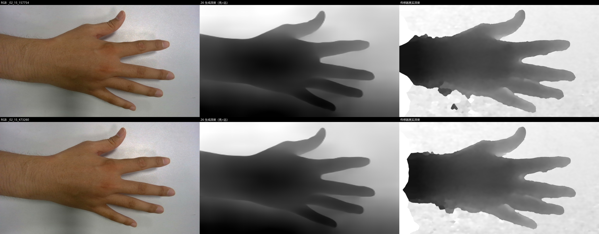

# 03-YOLO26 自生成深度 vs 传感器真实深度

> 记录第三阶段：让 YOLO26 用同一张彩色照片**自己算出深度图**，拿它当第 4 层输入，
> 与深度相机的真实深度比——**谁的深度对定位更有用**。
> 第二阶段的全部实验见 `02-Multi-YOLO-RGB.md`，本文不重复。
> 图都在 `docs/figures/`，原始数据在 `runs/`。

---

## 一、背景

### 起点

第二阶段已经把真实深度摸清了：

第二阶段已经确认：

| 事实 | 出处 |
|---|---|
| 深度对 v8（−17.6%）、26（−25.5%）有用 | 02 文档 4.18 |
| 深度对 11 没用（+1.6%），且 11 只看"整体亮度" | 02 文档 4.18、4.16 |
| 深度里存在能区分 7 个点的几何信息（7 点差 408mm） | 02 文档 4.16 |

第三阶段的问题变成：

> 如果**没有深度相机**，用单目估计出来的深度，能不能替代它？

这个问题有两个现实意义：
1. **工程意义**：能替代 → 只需一个普通摄像头就能部署，成本大降。
2. **学术意义**：真实深度"信息更好"但模型用不好；生成的深度如果反而更可用，
   说明**问题不在信息量，而在信息的形式**。

---

### 目标

一句话：**没有深度相机时，单目生成的深度能不能顶上？**

拆成三个要回答的问题：

```
① 生成深度的质量够不够（方向对不对、结构像不像）
② 换成生成深度后，三代模型各自变好还是变差
③ 如果 26 用得好、11 用得差，原因能不能指出来
```

### 不做什么

- 不训练自己的深度估计模型（直接用 `yolo26n-depth.pt`）
- 不追求绝对尺度（生成深度没有"米"，本文只比结构）
- 不改第二阶段的训练集与超参，三代同起点、同超参、只换第 4 层

---

## 二、计划

### 路线

```
生成 175 张深度 → 目视抽查 → 三代各训一个生成深度模型
                                  │
                                  ▼
                    3×3 对比（三代 × 三种第 4 层）
                                  │
                                  ▼
                    对三个生成深度模型各跑 34 项深度矩阵
                                  │
                                  ▼
                    看"破坏结构会不会变差" → 判断谁真的在用几何
```

### 判据

| 判据 | 含义 |
|---|---|
| **C < B** | 生成深度比真实深度更好 → "形式"比"信息量"更重要，是强结论 |
| **C ≈ B（±2%）** | 生成深度可以替代真实深度 → 工程意义成立 |
| **B < C** | 真实深度仍更优 → 与常识一致，说明第二阶段 11 的异常确实出在"信息形式"上 |
| 附加 | 若 C 组的 34 项矩阵里"填平均值"仍能让它变好，说明换成生成深度也没跳出 11 的老毛病 |

**噪声地板**：安慰剂实验为 ±0.5%，本文所有差异 **±2% 以内按噪声处理**。

---

### 名词

| 名词 | 一句话解释 |
|---|---|
| **生成深度** | 从彩色图算出来的深度，只有相对形状，没有"米" |
| **真实深度** | 深度相机测出来的，单位毫米，有绝对尺度 |
| **第 4 层 / 第 4 通道** | 拼在彩色图后面的那张黑白深度图，越亮 = 越远 |
| **34 项矩阵** | 对第 4 层做 34 种破坏，看定位误差怎么变 |
| **NME / 命中** | 定位误差（越小越好）/ 预测框与标注框重合度 ≥0.5 才算找到 |

---

## 三、实录

### 1. 先确认 26 有没有深度能力

| 项 | 结论 |
|---|---|
| 支持情况 | `ultralytics 8.4.175` 的 `TASKS` 里含 `depth` |
| 权重 | `yolo26n-depth.pt`（12.4 MB，已下载到 `MultiYoloRGB/yolo26n-depth.pt`） |
| 模型类 | `DepthModel`（`nn/tasks.py:838`），head 输出单通道 **对数深度**，上采样 2× |
| 调用 | `YOLO("yolo26n-depth.pt").predict(img)` → `results[0].depth`（`DepthMap` 对象） |
| 实测输出 | 形状与输入同尺寸（720×1280），数值范围 0.537~0.700（相对值，无绝对尺度） |

实测样例（`runs/depth26_preview.png`）：手暗、背景亮，与真实深度**方向一致、结构相似**。

**关键限制**：输出是**相对深度**（只有形状，没有米）。原注释见 `models/yolo/depth/calibrate.py`：
"log-depth head predicts relative scene structure (shape); absolute scale is a separate step"。

---

### 2. 生成深度怎么编码、怎么划数据集

**对照设计（最终做成 3×3）**

三代的检测模型 **v8 / 11 / 26 全部参与**，每一代都跑三种第 4 层：

| | 只有 RGB | 传感器真实深度 | 26 生成深度 |
|---|---|---|---|
| YOLOv8n-Pose | 已有 | 已有 | **新训** |
| YOLO11n-Pose | 已有 | 已有 | **新训** |
| YOLO26n-Pose | 已有 | 已有 | **新训** |

三代同起点、同超参、同一份训练划分，只在"第 4 层内容"上不同；
评测统一在同一份 100 张跨人图（生成深度组用对应的 `hand_common_gen`，图与标注完全一致）。
**只看 11 一组是不够的**——第二阶段的结论就是"11 是三代里的异类"，所以必须三代齐上。

**生成深度的编码方式**

真实深度的编码是：`1 + (clip(d, 1100, 1850) − 1100) × 254/750`，即**近=小、远=大**。

生成深度需要映射到同一区间，用逐张图的 min-max 归一化：

```
gen = 生成深度（0.5~0.7 的相对值）
ch4 = round(1 + (gen − gen.min()) / (gen.max() − gen.min()) × 254)
```

已知方向一致（手暗=近），无需翻转。
**备选**：按 2%/98% 分位数裁剪后再归一化（抗极值），作为稳健性检查。

**数据**

| 用途 | 需生成深度的图 | 数量 |
|---|---|---|
| 训练 + 验证 | `dataset/hand/rgb/images/*` | 75 |
| 跨人测试 | `dataset/hand_common/rgb/images/test` | 100 |

生成后落成两套 4 通道数据集：`dataset/hand_gen`、`dataset/hand_common_gen`。

---

### 3. 实际跑的五步

| 步 | 做什么 | 成本 |
|---|---|---|
| 1 | 用 `yolo26n-depth.pt` 生成 175 张深度图，归一化成第 4 通道 | ~1 分钟 |
| 2 | 目视检查 3~5 张：方向对不对、手的轮廓有没有、有没有整体偏移 | 2 分钟 |
| 3 | 训练 11-RGBD-生成深度（同起点、同超参、只换数据） | ~5 分钟 |
| 4 | 三组对比评测（A/B/C），conf=0.05，100 张 | ~1 分钟 |
| 5 | 对生成深度模型跑 34 项深度矩阵（看它是不是也"只看亮度"） | ~1.5 分钟 |

---

### 4. 生成深度长什么样：结构像，但更平滑

**生成深度的质量（先确认它像不像）**

脚本生成后抽查两项：

| 项 | 值 |
|---|---|
| 与真实深度的结构相似度（秩相关，测试集 112 张） | 中位数 **0.793**，最小 0.380，最大 0.916 |
| 分辨率 / 方向 | 与原图同尺寸；手暗（近）、背景亮（远），**方向与传感器编码一致** |



肉眼看：形状对得上，但生成深度**更平滑**（手指边缘模糊、背景是渐变而不是平台），
且没有传感器那种整块无效区域（黑色边框）。

统计明细：`runs/generated_depth_stats.csv`（每张图的生成范围、归一化后范围、与真实深度的相似度）。

**完整 3×3：三代 × 三种第 4 层（100 张跨人图，全部 100/100 命中）**

| 模型 | 只有 RGB | 传感器真实深度 | **26 生成深度** | 生成 vs 只有RGB | 生成 vs 真实深度 |
|---|---|---|---|---|---|
| YOLOv8 | 0.081902 | 0.067528 | 0.080016 | −2.3% | **+18.5%（更差）** |
| YOLO11 | 0.069164 | 0.070291 | 0.069638 | +0.7% | −0.9%（打平） |
| **YOLO26** | 0.079497 | 0.059237 | **0.054106** | **−31.9%** | **−8.7%（更好）** |

三个模型三种反应，没有统一答案：

- **26：生成深度比真实深度还好 8.7%，0.0541 是全部实验里的最好成绩。**
- **11：两种深度打平，都不如只用 RGB。**
- **v8：生成深度明显更差（比真实深度差 18.5%），相对 RGB 只有 −2.3% 的微弱收益。**

**三组模型的深度敏感度（各 34 项矩阵）**

"谁真的在用几何"，看"破坏结构会不会变差"最直接：

| 改动 | v8+真实 | **v8+生成** | 11+真实 | **11+生成** | 26+真实 | **26+生成** |
|---|---|---|---|---|---|---|
| 基线 | 0.067528 | 0.080016 | 0.070291 | 0.069638 | 0.059237 | **0.054106** |
| 深度反转 | +6.2%（99） | −0.3%（99） | −15.4%（98） | −14.7%（100） | +4.8%（100） | **+12.3%**（100） |
| 填成平均值 | +9.1%（98） | −1.7%（100） | −12.4%（100） | −7.8%（100） | +2.4%（100） | +3.5%（100） |
| 深度清零 | +11.9%（100） | +0.7%（99） | +53.0%（73） | −9.8%（100） | +7.7%（100） | +1.5%（100） |
| 只留边缘 | +7.8%（100） | +0.2%（99） | +42.3%（68） | −5.2%（100） | +14.5%（100） | +6.9%（100） |
| 上下镜像 | +9.8%（84） | −4.6%（97） | −15.5%（100） | −5.2%（88） | +2.7%（100） | +2.8%（100） |
| 像素打乱 | 崩（0/100） | **+54.6%（6/100）** | 崩（8/100） | 崩（0/100） | +40.0%（86） | **+80.3%（85）** |
| 第 1 层 ×0.5 | +33.0%（88） | −1.7%（100） | −14.9%（100） | −11.6%（100） | +11.3%（100） | +3.5%（100） |

**这张表解释了 7.2 的差异**：

1. **26+生成 对结构最敏感**：打乱 +80.3%、反转 +12.3%、只留边缘 +6.9%、清零 +1.5%
   —— 凡是破坏"哪里近哪里远"的改动，它都变差（只有清零在噪声内）。
   → **26 真的在用深度的几何**；生成深度更平滑、无空洞、无传感器噪声，所以它用得更好。
2. **v8+生成 几乎不敏感**（除打乱外基本在 ±5% 内）
   → 生成深度对它**几乎没提供信息**，这正好解释了它"相对 RGB 只 −2.3%"。
3. **11+生成 老毛病原样复现**：反转 −14.7%、填平均值 −7.8%、第 1 层 ×0.5 −11.6%。
   → 换深度来源也改变不了 11 的用法。
4. 一个反直觉现象：**11+生成 的"清零"从 +53.0% 变成 −9.8%**
   → 用生成深度训出来的 11 对深度依赖更弱，甚至"没有深度更好"。
   **精度相同 ≠ 用法相同。**

### 5. 三代三种反应，没有统一答案

见上文 3×3 表：26 用生成深度最好（−8.7%），11 打平（−0.9%），v8 明显更差（+18.5%）。

### 6. 34 项矩阵解释了为什么

对结构最敏感的是 26+生成（打乱 +80.3%），几乎不敏感的是 v8+生成（除打乱外都在 ±5% 内）。

---

## 四、结论

### 回到开头的问题

| 问题 | 答 |
|---|---|
| ① 生成深度质量够不够 | 够。与真实深度秩相关中位 **0.793**，方向一致（手暗=近）；代价是更平滑、无传感器噪声 |
| ② 三代各自变好还是变差 | **26 更好（−8.7%）、11 打平（−0.9%）、v8 更差（+18.5%）**，没有统一答案 |
| ③ 原因能不能指出 | 能。26 对破坏深度结构最敏感 → 它真在用几何；生成深度更平滑正合它口味。v8 依赖真实深度的细节（空洞/噪声），剥掉就不行 |

按第 5 节事先定好的判据：

| 判据 | 实测 | 判定 |
|---|---|---|
| C < B（生成更好） | 26 上 −8.7%；v8 上 +18.5%；11 上 −0.9% | **只在 26 上成立** |
| C ≈ B（±2%，可替代） | 11 上 0.9% | 仅对 11 成立 |
| B < C（真实深度更优） | v8 上 18.5% | **对 v8 成立** |

**能说的四句话**：

1. **"生成深度能不能替代真实深度"没有统一答案，取决于用哪一代模型**：
   26 上更好（−8.7%）、11 上打平（−0.9%）、v8 上明显更差（+18.5%）。
2. **26 + 生成深度是全部实验里的最好成绩**：0.054106（100/100 命中），
   比 26 用真实深度（0.059237）好 8.7%，也优于 11 的反转训练（0.0560）。
3. **原因可以指出**：26 对"破坏深度结构"最敏感（打乱 +80.3%、反转 +12.3%、只留边缘 +6.9%），
   说明它真在用几何；而生成深度更平滑、无空洞、无噪声，正好适合它。
   相反，11 对两种深度都只吃"电平与方向"；v8 则依赖真实深度里的细节。
4. **11 的老毛病与深度来源无关**：反转、填平均值、第 1 层 ×0.5 在生成深度上照样有效。

**不能说的**：
- 不能说"生成深度普遍更好"——v8 上差 18.5%。
- 不能说"生成深度解决了 11 的问题"——三项干预照样有效。
- 不能说"任何场景都能替代深度相机"——只测了手 + 白墙、一个受试者、单 seed。

**待解释**：v8 为什么几乎用不上生成深度（它依赖真实深度的哪一部分：空洞、噪声、还是细节），
本次未测。

---

### 适用条件与边界

1. **两者不是同一种东西**：真实深度有绝对尺度（毫米），生成深度只有相对形状。
   归一化之后能比"结构有没有用"，**不能比"数值准不准"**。
2. 26 的深度模型在外部大数据集上训练，**没见过本项目的场景**，它主要靠遮挡关系推断深浅。
3. 训练集仍只有 1 个受试者 52 张，第三阶段不会改变这个限制。
4. 单 seed、单测试集（100 张）。

---

---

## 附录

### 附录 A：本轮用到的全部资源

#### A.1 权重指纹

| 文件 | 说明 |
|---|---|
| `yolo26n-depth.pt`（12.4 MB） | 深度生成模型，`ultralytics 8.4.175` 自带 |
| `train_weight/yolov8n_rgbd_4ch_gen.pt` | v8 生成深度（59 轮，最佳 39，md5 `1f72f778…`） |
| `train_weight/yolo11n_rgbd_4ch_gen.pt` | 11 生成深度（79 轮，最佳 59，md5 `fb14e60c…`） |
| `train_weight/yolo26n_rgbd_4ch_gen.pt` | 26 生成深度（115 轮，最佳 95，md5 `86a4bf13…`） |

对照组（只有 RGB / 真实深度）的权重见 `02` 文档附录 A。

#### A.2 数据集

| 用途 | 路径 | 数量 |
|---|---|---|
| 生成深度训练 + 验证 | `hand_back/datasets/hand_gen` | 75 |
| 生成深度跨人测试 | `hand_back/datasets/hand_common_gen` | 100 |
| 对应的 RGB / 真实深度版本 | `hand`、`hand_common` | 75 / 100 |

编码：`ch4 = round(1 + (gen − gen.min()) / (gen.max() − gen.min()) × 254)`，逐张图 min-max。

#### A.3 环境

`MultiYoloRGB\.venv`：Python 3.13.5 / torch 2.10.0+cu130 / **ultralytics 8.4.175** / RTX 4080 SUPER。

#### A.4 评估口径

`conf = 0.05`，`imgsz = 640`，IoU ≥ 0.50 算命中，跨人 100 张。
**噪声地板 ±0.5%（安慰剂），±2% 以内按噪声处理。**

#### A.5 用到的脚本

| 脚本 | 干什么 |
|---|---|
| `make_generated_depth_dataset.py` | 生成深度 → 4 通道数据集（含抽查统计与对比图） |
| `test_all.py` | 三组对比评测 |
| `depth_battery.py` | 34 项深度矩阵 |
| `render_generation_compare.py` | 出对比图 |

### 附录 B：产物清单

| 文件 | 说明 |
|---|---|
| `make_generated_depth_dataset.py` | 生成深度 → 4 通道数据集（含抽查统计与对比图） |
| `dataset/hand_gen`、`dataset/hand_common_gen` | 两套数据集（75 / 100 张） |
| `train_weight/yolov8n_rgbd_4ch_gen.pt` | v8 生成深度产物（59 轮，最佳 39，md5 `1f72f778…`） |
| `train_weight/yolo11n_rgbd_4ch_gen.pt` | 11 生成深度产物（79 轮，最佳 59，md5 `fb14e60c…`） |
| `train_weight/yolo26n_rgbd_4ch_gen.pt` | 26 生成深度产物（115 轮，最佳 95，md5 `86a4bf13…`） |
| `runs/generated_depth_stats.csv` | 每张图的生成深度统计与结构相似度 |
| `runs/depth_battery/*_4ch_gen/summary.csv` | 三个生成深度模型的 34 项矩阵 |
| `runs/test_gen_all/` | 三代生成深度模型在同一测试集上的评测 |
| `docs/fig-13-gen-vs-real.png` | 真实深度 vs 生成深度对比图 |

### 附录 C：复现

见附录 A.5 的四个脚本，依次运行即可；生成深度数据集重跑后结果可复现。

