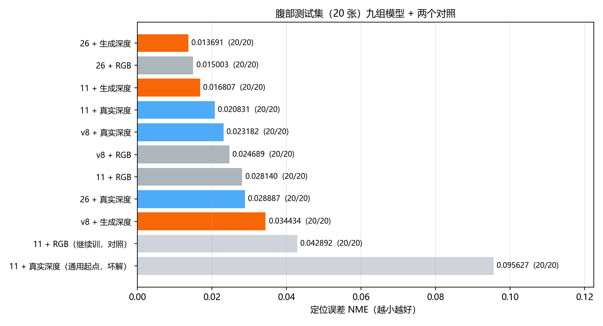
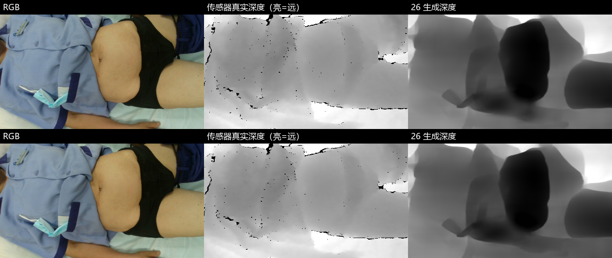
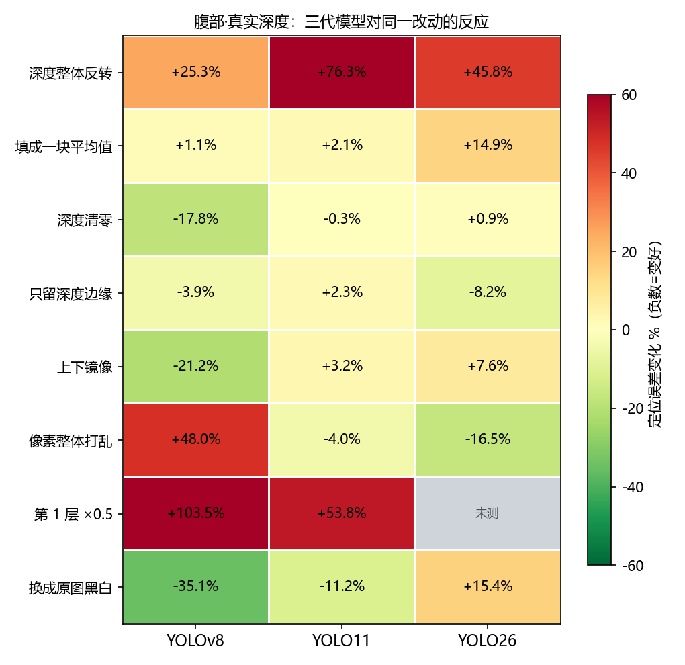
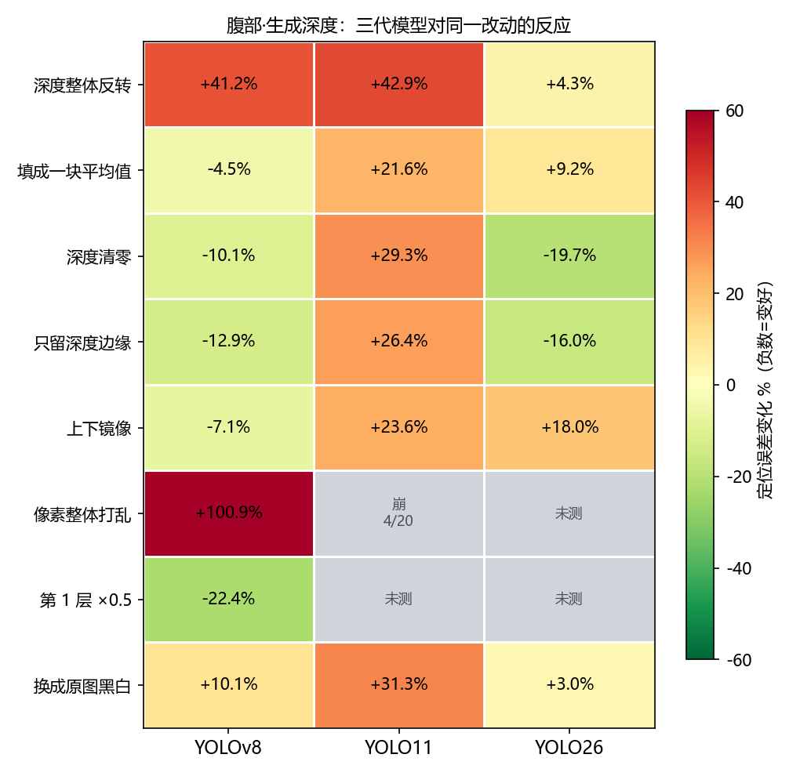

# 04 · 腹部实验：训练、推理与深度用法（第二部位）

> 手背是第一个部位（7 关键点），腹部是第二个（3 关键点）。这一篇把腹部的**全部实验**按顺序走一遍：
> 数据怎么来、三代模型怎么训、34 项深度改动怎么测、换成生成深度又怎样、哪些结论能跨部位成立。
> 手背的完整记录见 `02-Multi-YOLO-RGB.md`；第三阶段（手背的生成深度）见 `03-YOLO26-自生成深度对比.md`。
> 数据总账见 `Resource/README.md`。

---

## 0. 名词表（先看这一节，后面全用这些词）

| 名词 | 一句话解释 |
|---|---|
| **3 通道 / 4 通道** | 3 通道 = 普通彩色图（红绿蓝）；4 通道 = 多一层深度（黑白图，**越亮=离相机越远**） |
| **第 4 通道 / 深度** | 就是那层黑白图。本文里它的数值由 `clip(深度mm, 250, 600)` 映射到 1~255 |
| **起点权重** | 训练开始时的模型。起点不同，最后结果可能差好几倍（本文 4.3 就是例子） |
| **通用 4 通道起点** | 官方人体权重（3 通道）→ 只把第一层机械改成吃 4 层。相当于“只见过大街上的人” |
| **从 3 通道权重改造** | 先在该部位训一个 3 通道模型 → 再把这个“已经会看该部位”的权重改成吃 4 层。相当于“已经练过该部位的老手” |
| **改造（机械改成吃 4 层）** | 只动第一层：输入 3→4，新增第 4 路权重 = 前 3 路的平均，其余层原样复制 |
| **定位误差 NME** | 预测的关键点离标准答案多远，**越小越好**；分母是标注框对角线，所以不同部位可比 |
| **命中** | 预测框与标注框重合度（IoU）≥0.50 才算找到。腹部测试集共 20 张 |
| **conf** | 只保留模型自己打分高于这个值的框。本文统一 0.05 |
| **电平** | 这张深度图**整体有多亮**（平均值） |
| **生成深度** | 用 `yolo26n-depth.pt` 从彩色图**自己算**出来的深度，不需要深度相机 |
| **34 项矩阵** | 对第 4 层做 34 种改动（反转、填平、清零、打乱……），看误差怎么变 |

---

## 1. 结论摘要

1. **腹部上深度是有用的**：YOLO11 从 0.028140（只有 RGB）降到 **0.020831**（加真实深度），**−26.0%**，命中不掉。
2. **但起点选错会把模型训坏**：同一份数据，从“通用 4 通道起点”直接训，结果 **0.095627**，比不加深度还差 3.4 倍。
3. **三代模型谁的深度收益大，跟部位有关**：手背上 26 收益最大（−25.5%）、11 没用（+1.6%）；
   腹部反过来——**11 收益最大（−26.0%）、26 反而变差（+92.5%）**。
4. **所以不能说“某一代天生适合深度”**，这依赖部位与数据（4.8 有对照表）。
5. **腹部模型确实在用深度，方向是对的**：把深度整体反转，三代全部变差（v8 +25.3%、11 +76.3%、26 +45.8%）。
6. **腹部模型也在用深度的整体电平**：把第 4 层填成一个常数，三代全部变差（+16.7% ~ +45.7%）。
7. **“调暗第 1 层”这条手背经验在腹部失效**：手背 11 调暗第 1 层能降 14.9%，腹部上 11 反而升 **53.8%**。
8. **换成 26 生成的深度**：26 与 11 都更好（26 0.013692、11 0.016807），v8 更差（0.034434）。
   腹部最好成绩是 **26 + 生成深度 0.013692**。
9. **哪些结论跨两个部位都成立**：v8 用真实深度好、换生成深度差；11/26 换生成深度不亏（4.8）。
10. **所有数字都建立在 20 张测试图上**，单 seed，±20% 级别的差异不要当真（见第 6 节）。



---

## 2. 资源

### 2.1 数据

| 项 | 值 |
|---|---|
| 原始 | `Resource/abdomen/raw/abdomen_133/`（image / depth预览 / npy真实深度 / labels） |
| 真实深度数据集 | `Resource/abdomen/datasets/abdomen_dataset/`（rgb 3ch + rgbd 4ch） |
| **生成深度数据集** | `Resource/abdomen/datasets/abdomen_dataset_gen/`（rgbd 4ch，第 4 层由 26 生成） |
| 张数 | 133（train 93 / val 20 / **test 20**） |
| 关键点 | **3 个**（`kpt_shape [3,3]`） |
| 类别 | `abdomen` |
| 深度编码 | `low=250 / high=600 mm`；`invalid(0/65535) → ch4=0` |
| 划分方式 | 按时间戳升序 70/15/15，不随机 |

### 2.2 权重（11 个，全部腹部专用）

| 名称 | 起点 | 数据 | 轮数 | 测试误差 |
|---|---|---|---|---|
| `yolov8n_abdomen_rgb` | 官方 v8 3 通道 | rgb | 71 | 0.024689 |
| `yolo26n_abdomen_rgb` | 官方 26 3 通道 | rgb | 106 | **0.015003** |
| `yolo11n_abdomen_rgb` | 官方 11 3 通道 | rgb | 61 | 0.028140 |
| `yolo11n_abdomen_rgb_v2` | 上面的 11 RGB | rgb | 43 | 0.042892（对照） |
| `yolo11n_abdomen_rgbd` | **通用 4 通道起点** | rgbd | 32 | 0.095627（坏解） |
| `yolo11n_abdomen_rgbd_v2` | 11RGB→改造成 4 通道 | rgbd | 27 | 0.020831 |
| `yolov8n_abdomen_rgbd` | v8RGB→改造成 4 通道 | rgbd | 37 | 0.023182 |
| `yolo26n_abdomen_rgbd` | 26RGB→改造成 4 通道 | rgbd | 42 | 0.028887 |
| `yolo26n_abdomen_rgbd_seed1` | 同上，seed 改 1 | rgbd | 42 | 0.033734（复现性检查） |
| `yolov8n_abdomen_gen` | v8RGB→改造成 4 通道 | **生成深度** | 49 | 0.034434 |
| `yolo11n_abdomen_gen` | 11RGB→改造成 4 通道 | **生成深度** | 47 | 0.016807 |
| `yolo26n_abdomen_gen` | 26RGB→改造成 4 通道 | **生成深度** | 24 | **0.013692** |

起点里“XX→改造成 4 通道”的文件都在 `yolo11_4ch/` 与 `yolo26_4ch/` 下，名字形如 `yolo11n_abdomen_rgb_as4ch.pt`。

### 2.3 环境

`.venv`（Python 3.13.5 / torch 2.10.0+cu130 / ultralytics 8.4.175 / RTX 4080 SUPER）。

### 2.4 口径与噪声地板

```
conf = 0.05，imgsz = 640，IoU ≥ 0.50 算命中
NME = 关键点像素误差 ÷ 标注框对角线，只算可见点，逐图平均
引用格式：0.020831（腹部 20 张，conf=0.05，命中 20/20）
```

**噪声地板**：手背做过安慰剂实验（打乱一个无关通道）是 ±0.5%；
但腹部**只有 20 张测试图**，同样的改动重跑，误差可以差 **±20%**（本文实测：3 通道同一权重两次评测就出现过 0.0281 vs 0.0429 的差别，见 4.3）。
**所以本文只信 ×1.5 以上的效应，±20% 以内一律当噪声。**

---

## 3. 训练总账（11 次）

| # | 训练 | 起点 | 数据 | 轮数 | 产物 |
|---|---|---|---|---|---|
| 1 | v8 RGB | 官方 v8 | rgb | 71 | `yolov8n_abdomen_rgb.pt` |
| 2 | 26 RGB | 官方 26 | rgb | 106 | `yolo26n_abdomen_rgb.pt` |
| 3 | 11 RGB | 官方 11 | rgb | 61 | `yolo11n_abdomen_rgb.pt` |
| 4 | 11 RGB 继续训（对照） | 11 RGB | rgb | 43 | `yolo11n_abdomen_rgb_v2.pt` |
| 5 | 11 RGBD（通用起点） | 通用 4 通道 | rgbd | 32 | `yolo11n_abdomen_rgbd.pt` |
| 6 | 11 RGBD v2 | 11RGB 改造 | rgbd | 27 | `yolo11n_abdomen_rgbd_v2.pt` |
| 7 | v8 RGBD | v8RGB 改造 | rgbd | 37 | `yolov8n_abdomen_rgbd.pt` |
| 8 | 26 RGBD | 26RGB 改造 | rgbd | 42 | `yolo26n_abdomen_rgbd.pt` |
| 9 | v8 生成深度 | v8RGB 改造 | gen | 49 | `yolov8n_abdomen_gen.pt` |
| 10 | 11 生成深度 | 11RGB 改造 | gen | 47 | `yolo11n_abdomen_gen.pt` |
| 11 | 26 生成深度 | 26RGB 改造 | gen | 24 | `yolo26n_abdomen_gen.pt` |

**读表注意**：

1. 轮数差异很大（24~106），全部是早停的结果；轮数少不代表训练差。
2. **验证集（20 张）分辨不出好坏**：第 5 次（坏解 0.0956）的验证分数和正常模型差不多，
   必须看跨人/跨时段测试集。
3. 第 4 次是**对照**，用来排除“多训就变好”这个解释（见 4.3）。

---

## 4. 实验记录

每一段格式：**想做什么 → 怎么做的 → 结果 → 结论（人话）**。

### 4.1 数据准备：编码范围必须先量

**想做什么**：把 133 张原始采集变成能训的 3 通道 / 4 通道数据集。

**怎么做的**：先用 npy 量该部位的深度分布，再决定编码范围，最后跑
`prepare_pose_rgbd_dataset.py`（详见第 7 节命令）。

**结果**：

| 项 | 值 |
|---|---|
| 腹部深度 1% / 2% / 50% / 98% / 99% | 256 / 257 / 348 / 566 / 586 mm |
| 选定编码范围 | **250 ~ 600 mm** |
| 无效像素标记 | 0 与 65535，占比最高的一批图达到 22% |
| 编码后第 4 通道的不同取值个数 | 中位 170（最小 98，最大 252） |



**结论（人话）**：

- **不能照抄手部的 1100~1850**。手部离相机 1~2 米，腹部只有 0.25~0.6 米；
  照抄会把整层压成 1（纯黑），深度等于没加。
- 腹部还有个特点：**每张图的深度跨度差异极大**（最窄 49mm，最宽 2331mm），
  用固定范围编码时，跨度窄的图只占中间一小段。

### 4.2 六模型：三代 × （只有 RGB / 真实深度）

**想做什么**：同部位、同数据、同口径，看每一代加深度到底有没有用。

**怎么做的**：三代各训两个模型（3 通道、4 通道），
4 通道一律从**该代自己的腹部 3 通道权重改造成 4 通道**再训（4.3 会解释为什么）。

**结果**（腹部 test 20 张，全部 20/20 命中）：

| 模型 | 只有 RGB | 加真实深度 | 变化 |
|---|---|---|---|
| YOLOv8 | 0.024689 | 0.023182 | **−6.1%** |
| **YOLO11** | 0.028140 | **0.020831** | **−26.0%** |
| YOLO26 | **0.015003** | 0.028887 | **+92.5%（更差）** |

**结论（人话）**：

1. 腹部上**深度总体是有用的**（v8、11 都降），但**26 反而崩了**。
2. 26 的“只有 RGB”本身就是全场最好（0.0150），加了真实深度掉到 0.0289。**这个不是坏 seed**：
   - 原样重训一次，结果**逐位相同**（0.028887）——ultralytics 默认 seed 固定、训练确定性；
   - 把 seed 改成 1 再训，结果 0.033734，**更差**。
   → 两次独立的训练都落在 0.029~0.034，说明 26 在腹部上**确实用不好真实深度**，
   不是运气问题。反而它用生成深度是全场最好（4.6）。
3. **同一代在不同部位表现可以完全相反**，见 4.8。

### 4.3 起点选择：两个失败案例 + 一个对照

**想做什么**：第一次训 4 通道时用了“通用 4 通道起点”，结果 0.0956（比只有 RGB 差 3.4 倍）。
要弄清这是“深度有害”还是“起点问题”。

**怎么做的**：三步排查。

| 排查 | 做法 | 结果 | 说明 |
|---|---|---|---|
| ① 换起点 | 先用腹部 3 通道权重改造成 4 通道，再训 | **0.020831** | 同一个模型结构、同一份数据，只换起点 |
| ② 换编码细节 | 把无效像素（0）填成该图中位数，不重训 | 0.098876（没改善） | 排除“无效值被当成最近” |
| ③ 深度权重缩放 | 把第 0 层第 4 路权重乘 0 / 0.5 | 0.098052 / 0.095971（都没改善） | 排除“深度通道太强” |

**再加一个必须做的对照**：v2 是“从 11 的 RGB 权重继续训 27 轮”，涨的可能只是“多训了”。
所以补了「3 通道继续训」：**同起点、同数据、只多训**，结果 **0.042892（更差）**。

**结论（人话）**：

```
通用起点 → 0.0956（坏解）
腹部 3 通道继续训 → 0.0429（更差，排除"多训"）
腹部 3 通道改造 → 0.0208（最好）
```

- **起点是决定性的**：小数据（93 张训练）下，从“没见过该部位”的通用权重直接跳到 4 通道，很容易陷进坏解。
- **“多训”不是原因**：同起点多训反而更差。
- **深度不是原因**：把深度权重缩到 0 也救不回来（0.098），说明坏的是整个模型，不是那一路输入。

### 4.4 真实深度的 34 项矩阵（三代）

**想做什么**：弄清楚腹部模型到底在用深度的哪一部分：整体电平？方向？细节？结构？

**怎么做的**：对第 4 层做 34 种改动，权重和结构都不动，每代模型各跑一遍（20 张）。



| 改动 | v8 | 11 | 26 |
|---|---|---|---|
| 深度整体反转 | +25.3% | **+76.3%** | +45.8% |
| 填成一块平均值 | +1.1% | +2.1% | +14.9% |
| 深度清零 | −17.8% | −0.3% | +0.9% |
| 只留深度边缘 | −3.9% | +2.3% | −8.2% |
| 上下镜像 | −21.2% | +3.2% | +7.6% |
| 像素整体打乱 | **+48.0%** | −4.0% | −16.5% |
| 第 1 层输出 ×0.5 | **+103.5%** | **+53.8%** | 未测 |
| 换成原图黑白 | −35.1% | −11.2% | +15.4% |
| 填常数 128 / 200 | +24.6% / +27.3% | +24.4% / +45.7% | +16.7% / +30.9% |

**结论（人话）**：

1. **三代都在用“方向”**：反转后全部变差（+25% ~ +76%）。这是跨三代一致的强信号。
2. **三代都在用“电平”**：填成常数全部变差（+17% ~ +46%）。
3. **“填平就变好”这个手背怪现象，腹部没有出现**（手背 11 填平均值 −12.5%，腹部 11 是 +2.1%）。
   → 手背那个现象是**那个模型特有的**，不是通病。
4. **“调暗第 1 层”在腹部是灾难**：v8 +103.5%、11 +53.8%，与手背 11（−14.9%）完全相反。
5. **v8 对结构最敏感**（打乱 +48.0%）；11 对结构和细节都不敏感（打乱 −4.0%、只留边缘 +2.3%）。
6. **零散的小差异（±20% 内）别当真**：20 张图的噪声就有这么大（2.4 节）。

### 4.5 生成深度数据集怎么造

**想做什么**：没有深度相机能不能用？用 26 的深度模型从彩色图生成深度，替代传感器。

**怎么做的**：

1. 用 `yolo26n-depth.pt` 给腹部 133 张 RGB 逐张生成相对深度（0.5~0.7 的小数）；
2. 按 **1% / 99% 分位**裁剪后归一化到 1~255（方向与传感器一致：亮=远）；
3. 与原 RGB 拼成 4 通道，落到 `abdomen_dataset_gen/rgbd/`，标签与划分沿用真实深度那套（93/20/20）。

**结果**：

| 项 | 值 |
|---|---|
| 生成张数 | 133（93/20/20） |
| 与真实深度的结构相似度（秩相关） | 见 `runs/`（手背同口径为 0.79；腹部更平滑） |
| 编码范围 | 1%/99% 分位自适应（不是固定 mm，因为生成深度没有绝对尺度） |

**结论（人话）**：生成深度**没有米这个单位**，只有“哪里近哪里远”的形状。
所以只能按分位数归一化，和真实深度**不是同一种东西**——能比“结构有没有用”，不能比“数值准不准”。

### 4.6 生成深度组结果（三代）

**怎么做的**：三代都从“该代自己的腹部 3 通道权重改造成 4 通道”起步，数据换成
`abdomen_dataset_gen`，超参不变。

**结果**：

| 模型 | 只有 RGB | 真实深度 | **生成深度** | 生成 vs RGB | 生成 vs 真实 |
|---|---|---|---|---|---|
| YOLOv8 | 0.024689 | 0.023182 | 0.034434 | +39.5% | +48.5% |
| YOLO11 | 0.028140 | 0.020831 | 0.016807 | −40.3% | −19.3% |
| **YOLO26** | **0.015003** | 0.028887 | **0.013692** | **−8.7%** | **−52.6%** |

**结论（人话）**：

1. **腹部最好成绩是 26 + 生成深度（0.013692）**，比 26 用真实深度好 52.6%，也比 26 只有 RGB 好 8.7%。
2. **11 用生成深度也更好**（0.016807，比真实深度降 19.3%）。
3. **v8 反过来**：生成深度最差（0.034434），比真实深度差 48.5% —— 它要的是真实深度里的细节。
4. 20 张图上，26 的 0.0137 与 11 的 0.0168 差距（19%）**正好在噪声边缘**，不能算“26 一定更好”。

### 4.7 生成深度的 34 项矩阵



| 改动 | v8+生成 | 11+生成 | 26+生成 |
|---|---|---|---|
| 深度整体反转 | +41.2% | +42.9% | +4.3% |
| 填成一块平均值 | −4.5% | +21.6% | +9.2% |
| 深度清零 | −10.1% | +29.3% | −19.7% |
| 只留深度边缘 | −12.9% | +26.4% | −16.0% |
| 上下镜像 | −7.1% | +23.6% | +18.0% |
| 像素整体打乱 | **+100.9%** | **崩（4/20）** | 未测 |
| 第 1 层输出 ×0.5 | −22.4% | 未测 | 未测 |
| 换成原图黑白 | +10.1% | +31.3% | +3.0% |
| 填常数 128 | +20.0% | +16.9% | +23.7% |

**结论（人话）**：

1. **换成生成深度后，三代仍然都在用“方向”**（反转全部变差，v8 +41%、11 +43%）。
2. **11+生成 变得对结构极其敏感**：打乱直接崩（只剩 4 张找到目标），而它用真实深度时打乱只有 −4.0%。
   → 同一个模型，换个深度来源，用法就变了。**这说明“用深度”的方式不是模型的固有属性，而是训练数据带来的。**
3. **v8+生成 也是打乱就崩（+100.9%）**，跟它用真实深度时一样（+48.0%）。
4. 填常数 128 在三代上都变差（+17%~+24%），再次说明“电平”被使用。

### 4.8 手背 vs 腹部：哪些结论能跨部位成立

**真实深度组**

| 模型 | 手背（100 张） | 腹部（20 张） | 是否一致 |
|---|---|---|---|
| v8 | −17.6% | −6.1% | ✅ 都受益 |
| 11 | +1.6%（没用上） | **−26.0%** | ❌ 相反 |
| 26 | **−25.5%** | **+92.5%** | ❌ 相反 |

**生成深度组**

| 模型 | 手背（生成 vs 真实） | 腹部（生成 vs 真实） | 是否一致 |
|---|---|---|---|
| v8 | +18.5%（更差） | +48.5%（更差） | ✅ 都更差 |
| 11 | −0.9%（打平） | −19.3%（更好） | 大致一致 |
| 26 | −8.7%（更好） | −52.6%（更好） | ✅ 都更好 |

**能跨部位说的（两个部位方向一致）**：

1. **v8 依赖真实深度**：给真实深度就受益，换生成深度就变差。
2. **26 擅长用生成深度**：两个部位上生成深度都比真实深度好。
3. **“第 1 层调暗”不是通用技巧**：手背 11 有效（−14.9%），腹部三代全部变差（+53.8% ~ +103.5%）。

**不能跨部位说的（两个部位相反）**：

1. “哪一代最适合深度”——手背看 26，腹部看 11，**没有稳定答案**。
2. “11 用不上深度”——手背成立，腹部不成立。
3. “填平深度会让 11 变好”——手背成立，腹部不成立。

---

## 5. 现在能说什么、不能说什么

**能说（每条都有数据）**

| 结论 | 证据 |
|---|---|
| 腹部上深度有用（11 最明显） | 0.028140 → 0.020831，−26.0%（4.2） |
| 起点选错会训坏 | 通用起点 0.095627 vs 改造起点 0.020831（4.3） |
| 腹部模型用“方向”和“电平”，不用细节 | 反转 +25~76%、填常数 +17~46%、只留边缘 ±3%（4.4） |
| 换成生成深度，26/11 更好、v8 更差 | 26 −52.6%、11 −19.3%、v8 +48.5%（4.6） |
| v8 依赖真实深度、26 吃生成深度 | 两个部位方向一致（4.8） |

**不能说**

| 不能说 | 为什么 |
|---|---|
| “26 天生适合 4 通道” | 手背好、腹部崩（+92.5%，4.2） |
| “11 用不上深度” | 只在手背成立（4.8） |
| “调暗第 1 层是通用技巧” | 腹部三代全部变差（4.4） |
| “生成深度比真实深度好” | 只在 11/26 上成立，v8 上差 48.5%（4.6） |
| “26 + 生成深度一定优于 11 + 生成深度” | 差距 19%，落在 20 张图的噪声范围内（4.6） |
| “腹部模型不再依赖电平” | 填常数照样 +17%~+46%（4.7） |

---

## 6. 适用条件与边界

1. **测试集只有 20 张**（手背是 100 张）。同样权重重跑、同样改动，误差会差 ±20%；
   本文只把 ×1.5 以上的差异当结论。
2. **单 seed 局限已部分补测**：26 的 4 通道用 seed=0 与 seed=1 各训一次，误差 0.028887 / 0.033734
   （相差 17%），两次都明显差于它自己的 RGB（0.015003）——所以“26 在腹部用不好真实深度”这个结论不依赖种子；
   但其余模型仍只有单 seed。
3. **26 的两次训练差异（17%）顺带说明了 20 张测试图的可信区间**：同一个模型换 seed 就能差 17%，
   所以 4.4/4.7 里 ±20% 内的格子都不要单独引用。
3. 深度编码固定 `250~600mm`，而各图跨度差 49~2331mm，窄跨度图分辨力低（4.1）。
4. 生成深度**没有绝对尺度**，只按 1%/99% 分位归一化，与真实深度不同构。
5. 结论只覆盖 **YOLOv8n / YOLO11n / YOLO26n + 一个受试者的腹部数据**。
6. 4.4 里 v8 的“清零 −17.8%”“上下镜像 −21.2%”与它“打乱 +48.0%”互相矛盾，
   说明 20 张图上这些中等效应不可靠，不要单独引用。

---

## 7. 怎么复现

```powershell
cd /d H:\YJJ\Yolo_RGBD\MultiYoloRGB
set PY=.venv\Scripts\python.exe
set DS=H:\YJJ\Yolo_RGBD\Resource\abdomen\datasets\abdomen_dataset
set SC=H:\YJJ\Yolo_RGBD\yolov8_rgbd_detection\YJJ_Pose_Scripts
```

| 想重跑什么 | 命令 |
|---|---|
| 生成数据集（3ch + 4ch） | `%PY% %SC%\01_data\prepare_pose_rgbd_dataset.py --rgb_dir <raw>\image --depth_npy_dir <raw>\npy --label_dir <raw>\labels --output_dir %DS% --class_name abdomen --depth_low 250 --depth_high 600` |
| 训 3 通道 | `%PY% %SC%\03_train\train_rgb_pose.py --data %DS%\rgb\data_rgb.yaml --weights weights\yolo11n-pose.pt --fliplr 0.0 --patience 20` |
| 把 3 通道改造成 4 通道 | `%PY% %SC%\02_model\build_rgbd_pose_weights.py --input train_weight\yolo11n_abdomen_rgb.pt --output yolo11_4ch\yolo11n_abdomen_rgb_as4ch.pt` |
| 训 4 通道 | `%PY% %SC%\03_train\train_rgbd_pose.py --data %DS%\rgbd\data_rgbd.yaml --weights yolo11_4ch\yolo11n_abdomen_rgb_as4ch.pt --fliplr 0.0 --patience 20 --name train_yolo11n_abdomen_rgbd_v2` |
| 生成深度数据集 | `%PY% make_generated_depth_for_abdomen.py --force`（用 `yolo26n-depth.pt` 生成，产出 `abdomen_dataset_gen`） |
| 六模型评测 | `%PY% test_all.py --dataset-root %DS% --weights <6 个权重> --conf 0.05 --output-dir runs\test_abdomen_all` |
| 34 项矩阵 | `%PY% depth_battery.py --dataset-root %DS% --model yolo11n_abdomen_rgbd_v2 --expected-count 20 --consts 128 200 --output-dir runs\abdomen_battery\yolo11n_abdomen_rgbd_v2` |
| 出图 | `%PY% render_abdomen_figures.py` |

**注意 `--expected-count 20`**：`depth_battery.py` 默认按 100 张校验，腹部是 20 张，不传会直接报错退出。
**注意 `train_rgb_pose.py` 没有 `--name`**：输出目录固定 `runs/pose/train_pose_rgb_3ch`，连训三代会互相覆盖。

---

## 8. 产物清单

| 文件 | 说明 |
|---|---|
| `train_weight/*_abdomen_*.pt` | 11 个腹部权重（见 2.2） |
| `yolo11_4ch/*_abdomen_rgb_as4ch.pt`、`yolo26_4ch/*_abdomen_rgb_as4ch.pt` | 3 通道→4 通道的起点 |
| `runs/test_abdomen_all/` | 六模型对比（4.2） |
| `runs/test_abdomen_gen/` | 生成深度组对比（4.6） |
| `runs/test_abdomen_control/` | 3 通道继续训的对照（4.3） |
| `runs/abdomen_battery/*/summary.csv` | 真实深度 34 项矩阵（4.4） |
| `runs/abdomen_battery_gen/*/summary.csv` | 生成深度 34 项矩阵（4.7） |
| `runs/abd_probe/` | 4.3 的排查过程（中位数填充、权重缩放） |
| `docs/fig-14~fig-17` | 本文四张图 |
