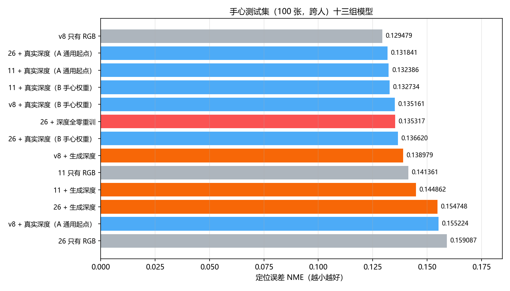
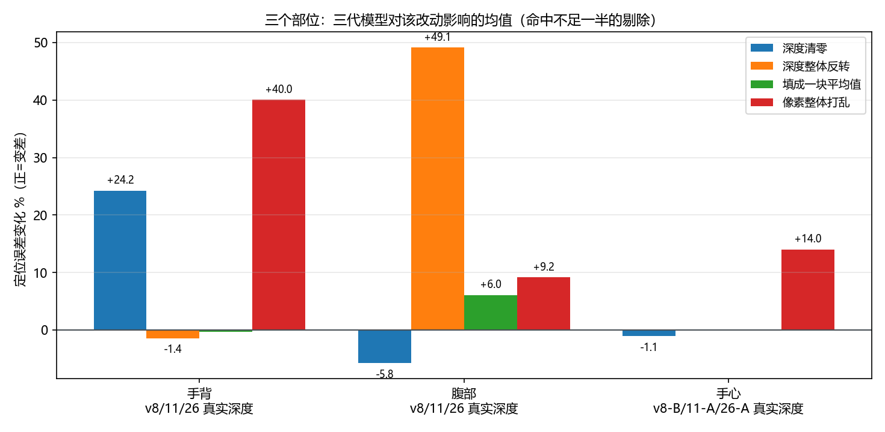

# 05 · 手心：第三部位与"4 通道收益从哪来"

> 记录第三部位（手心，6 个关键点）的全部实验。
> 这一篇的核心发现和前两篇不同：**手心 4 通道比 3 通道好 17%，但这 17% 几乎与深度无关。**
> 手背见 `02-Multi-YOLO-RGB.md`，手背生成深度见 `03-YOLO26-自生成深度对比.md`，腹部见 `04-腹部实验-全部实验记录.md`。
> 图都在 `docs/figures/`。

---

## 一、背景

### 起点

前两个部位给出两条互相矛盾的线索：

| 部位 | 深度对定位 | 能不能跨部位讲 |
|---|---|---|
| 手背 | v8 −17.6%、26 −25.5%、11 +1.6% | 只有 v8/26 受益 |
| 腹部 | 11 −26.0%、v8 −6.1%、26 +92.5% | 只有 11 受益 |

两处的共同结论是"某几代受益"，但**受益的是哪一代并没有一致答案**。
手心是第三个部位，用来判断这到底是"部位依赖"还是"数据量/难度"的问题。

### 目标

```
① 手心上加深度，三代各自变好还是变差
② 起点选择（通用 4 通道 vs 本部位 RGB 改造）在手心上影响多大
③ 4 通道的收益，到底有多少来自深度本身
```

第 ③ 问是这一篇真正的重点。

### 不做什么

- 不换 backbone、不改网络结构
- 不做多受试者（训练 1 人、测试另 1 人，与前两部位一致）
- 不从零设计深度编码（照手背的确定性映射，只改 clip 范围）

---

## 二、计划

### 路线

```
量深度分布定范围 → 生成 3ch/4ch 数据集
      │
      ▼
三代各训 3ch（基线）+ 三代各训 4ch-A（通用起点）→ 六模型对比
      │
      ▼
A 明显变差的那一代，走 4ch-B（本部位 RGB 权重改造重训）
      │
      ▼
对三代最好的 4ch 模型各跑 34 项深度矩阵 → 它到底用不用深度
      │
      ▼
生成深度那一轮：造数据集 → 三代重训 → 评测 → 34 项
      │
      ▼
决定性对照：第 4 层全零重训 → 把"深度的贡献"和"多一个通道的贡献"分开
```

### 判据

| 判据 | 说明 |
|---|---|
| 命中不掉 | 100 张测试图，命中 < 100 视为该条件不可比 |
| 差 > 20% 判为坏解 | 走 B 阶段 |
| **噪声地板 ±5%** | 100 张测试图；训练换 seed 在腹部 20 张上能差 17%，100 张按 ±5% 估 |
| 能指向 CSV | 每个数字必须能在 `runs/` 下找到 |

### 名词

| 名词 | 一句话解释 |
|---|---|
| **3 通道 / 4 通道** | 3 通道 = 彩色图；4 通道 = 多一层深度（黑白，越亮=越远） |
| **4ch-A（通用起点）** | 官方 3 通道权重直接机械改造成 4 通道，再训手心 |
| **4ch-B（本部位权重）** | 先用手心数据训出 3 通道模型，再把这个权重改造成 4 通道 |
| **第 4 层全零重训** | 把深度通道全填 0 后从头训 —— 结构还是 4 通道，但没有任何深度信息 |
| **NME / 命中** | 定位误差（越小越好）/ 预测框与标注框重合度 ≥0.5 才算找到 |
| **34 项矩阵** | 对第 4 层做 34 种改动，看定位误差怎么变 |

---

## 三、实录

### 1. 深度范围必须重量：手心是 1500~1920 mm

| 组 | 1% | 2% | 50% | 98% | 99% |
|---|---|---|---|---|---|
| g01（训练+验证） | 1492 | 1522 | 1656 | 1914 | 1925 |
| g02（测试） | 1488 | 1508 | 1657 | 1895 | 1905 |

取 `clip(1500, 1920) mm`。**跨度只有 420mm**，手背是 750mm，所以编码分辨率约为手背的 1.8 倍粗。

保真校验（第 4 层 vs 裁剪后原始深度）：Pearson / Spearman 全为 **1.000000**，
通过主仓脚本 0.999 的断言。

### 2. 数据划分：同一个人训练，另一个人测试

```
g01（101 张已标）→ train 81 / val 20
g02（100 张已标）→ test 100      ← 训练全程不看
```

g02 有 101 张，其中 1 张太糊没标，已跳过。

### 3. 三代各训 3 通道：手心比手背难得多

| 代 | NME | 命中 | 轮数 |
|---|---|---|---|
| v8 | 0.129479 | 100/100 | 56 |
| 11 | 0.141361 | 100/100 | 55 |
| 26 | 0.159087 | 100/100 | 48 |

作为参照，手背同口径是 0.068~0.082。手心的 6 个点挤在掌心一小块区域，
框小、点密，归一化后误差自然更大。

### 4. A 阶段：11 和 26 受益，v8 掉队

| 代 | 3 通道 | 4ch-A（通用起点） | 变化 |
|---|---|---|---|
| v8 | 0.129479 | 0.155224 | **+19.9%（更差）** |
| 11 | 0.141361 | **0.132386** | −6.4% |
| 26 | 0.159087 | **0.131841** | **−17.1%** |

v8 的 A 模型早停在 **epoch 18**（只训 38 轮），是收敛到差解的典型迹象，
所以按事先判据对 v8 走 B 阶段。

### 5. B 阶段：只救回 v8 的一半

| 代 | 4ch-A | 4ch-B（手心 RGB 改造） | 结论 |
|---|---|---|---|
| v8 | 0.155224（+19.9%） | **0.135161（+4.4%）** | B 救回 13 个百分点 |
| 11 | 0.132386（−6.4%） | 0.132734（−6.1%） | A ≈ B |
| 26 | 0.131841（−17.1%） | 0.136620（−14.1%） | A 略好 |

**和腹部完全不同**：腹部 A 阶段崩到 +240%，B 从 +240% 一路救到 −26%（质变）；
手心 A 最差只到 +19.9%，B 也只救回 +4.4%。

原因查到两条：

1. **验证集饱和了。** 九个模型的 val `mAP50(B)` 全是 **0.995**，早停分辨不出好坏。
   腹部验证集也是 20 张，但数据更难、分数没饱和，所以坏解会被抓住。
2. **B 的模型几乎没训练。** best 轮次：v8-B 是 **epoch 1**、11-B 是 9、26-B 是 50。
   v8-B 的 `best.pt` 基本等于"手心 RGB 权重 + 一轮训练"，深度层只是初始化的那个
   「RGB 三通道平均值」，模型没机会学它。

### 6. 34 项矩阵：手心模型根本不用深度

对每一代取最好的那个 4 通道模型：

| 改动 | v8-B | 11-A | 26-A |
|---|---|---|---|
| 基线 | 0.135161 | 0.132386 | 0.131841 |
| **深度清零** | **−1.4%** | **−0.8%** | **−0.9%** |
| 深度整体反转 | −1.1% | +0.2% | +0.6% |
| 填成一块平均值 | −0.2% | +0.3% | +0.1% |
| 只留深度边缘 | +0.4% | −1.2% | −0.4% |
| 上下镜像 | +0.1% | +0.8% | −0.3% |
| 填常数 128 / 200 | −0.2% / −0.2% | +0.2% / +0.7% | +0.0% / +0.6% |
| 第 1 层输出 ×0.5 | +3.7% | +1.0% | −0.1% |
| 换成原图黑白 | −1.4% | −0.3% | −0.5% |
| **像素整体打乱** | +1.8%（100） | +26.2%（**79**） | +11.1%（**7**） |

**除"打乱"以外，全部落在 ±1.5% 内**，而打乱还会让命中数崩到 79 / 7。

对比手背同一项（清零）：**+11.9% / +53.0% / +7.7%**。

读法：手心模型对深度的**内容完全不敏感**——改方向、改电平、填平、清零都不影响；
只有把第 4 层变成随机噪点才会崩，那是"输入分布被破坏"，不是"没有几何"。

### 7. 生成深度那一轮：三代都不如真实深度

用 `yolo26n-depth.pt` 生成手心深度（1%/99% 分位归一化），三代从各自 B 起点重训：

| 代 | 3 通道 | 真实深度（最好） | 生成深度 | 生成 vs 真实 |
|---|---|---|---|---|
| v8 | 0.129479 | 0.135161 | 0.138979 | +2.8% |
| 11 | 0.141361 | 0.132386 | 0.144862 | +9.4% |
| 26 | 0.159087 | 0.131841 | 0.154748 | **+17.4%** |

生成深度三模型同样对深度不敏感（清零 −0.0~+0.2%、反转 −1.2~−2.0%）。

**手背上"26 吃生成深度"那条结论在手心上不成立**——这里 26 用生成深度反而最差。

### 8. 决定性对照：第 4 层全零重训

把整个数据集的第 4 层填 0（结构还是 4 通道，但没有任何深度信息），用 26 从头训：

| 26 的三种配置 | NME | 相对 3 通道 |
|---|---|---|
| 只有 RGB（3 通道） | 0.159087 | — |
| 4 通道 + 真实深度 | **0.131841** | **−17.1%** |
| **4 通道 + 深度全零** | **0.135317** | **−14.9%** |

**深度全零的模型拿到了 −14.9%，真实深度只比它好 2.6%。**

这 2.6% 落在 ±5% 噪声地板内。所以：

> 手心 4 通道相对 3 通道的 17% 提升，其中约 **15% 来自"多了一个输入通道"这个结构变化本身**，
> 只有约 2.6% 可能来自深度内容，且不显著。

### 9. 三个部位横向对照





| 部位 | 清零 | 反转 | 填平 | 打乱 | 结论 |
|---|---|---|---|---|---|
| 手背 | **+24.2%** | −1.4% | −0.3% | **+40.0%** | 用"电平"和"结构" |
| 腹部 | −5.8% | **+49.1%** | +6.0% | +9.2% | 用"方向" |
| **手心** | **−1.1%** | **−0.1%** | **−0.1%** | +14.0% | **什么都不用** |

（表中为三代均值；命中不足一半的条件已剔除。）

---

## 四、结论

### 回到开头的问题

| 问题 | 答 |
|---|---|
| ① 手心加深度，三代各自变好还是变差 | 表面看：26 −17.1%、11 −6.4%、v8 不变（B +4.4%）。**但这个"变好"不是深度带来的**，见 ③ |
| ② 起点选择影响多大 | 比腹部小得多。A 最差 +19.9%，B 救回到 +4.4%；11/26 上 A 和 B 打平或 A 略好。**"必须用本部位权重改造"这条经验只在 v8 上成立** |
| ③ 4 通道的收益有多少来自深度 | **几乎没有**。深度全零重训仍拿到 −14.9%，真实深度只多 2.6%（噪声内）。17% 的收益里约 15% 来自"多一个输入通道"这个结构变化 |

**一句话：手心上的 4 通道是个"空转"的通道——它让模型训得更好，但模型不读里面的深度。**

### 能说的

| 结论 | 证据 |
|---|---|
| 手心 4 通道比 3 通道好（26 上 −17.1%） | 0.159087 → 0.131841，100/100 命中（第 4 节） |
| **这份收益与深度内容无关** | 深度全零重训 −14.9%，真实深度只多 2.6%（第 8 节） |
| 手心模型对深度内容完全不敏感 | 清零/反转/填平/填常数全部 ±1.5% 内（第 6 节） |
| 起点选择的影响比腹部小 | A 最差 +19.9%，B 只救回 +4.4%；腹部是 +240% → −26%（第 5 节） |
| 生成深度在手心不如真实深度 | v8 +2.8%、11 +9.4%、26 +17.4%（第 7 节） |
| 三部位的深度用法各不相同 | 手背用电平、腹部用方向、手心什么也不用（第 9 节） |

### 不能说的

| 不能说 | 为什么 |
|---|---|
| "加深度让手心定位更准 17%" | 深度全零也能拿到 14.9%，收益与深度无关（第 8 节） |
| "26 天生适合生成深度" | 手背上成立，手心上 26+生成反而最差（+17.4%） |
| "任何部位都必须用本部位权重改造起点" | 手心只有 v8 需要，11/26 上 A 一样好甚至更好（第 5 节） |
| "手心模型学会了忽略无效深度" | 它不是"优雅降级"，而是从头到尾没读过深度内容（第 6 节） |
| "验证集分数能代表模型好坏" | 九个模型 val mAP50(B) 全是 0.995，但跨人测试差 15%（第 5 节） |
| "4 通道改造在所有部位都值得推荐" | 收益来源是结构而非信息，不能作为"深度有用"的证据 |

### 适用条件与边界

1. **单受试者训练、另一受试者测试**；训练 81 张、测试 100 张，都是右手。
2. **单 seed**，未做重复训练方差；±5% 以内一律当噪声。
3. 深度编码固定 `1500~1920 mm`，跨度只有 420mm，分辨率比手背粗约 1.8 倍。
4. g01 只标了 101 张、g02 只标了 100 张（1 张太糊跳过），g03~g05 未使用。
5. **验证集（20 张）已饱和**（mAP 0.995），选模型实际上只能看测试集；
   这意味着早停机制在手心上没有起到筛选作用。
6. "深度全零重训"只做了 26 一代，v8 与 11 未做。
7. 第 6 节"打乱"会让命中崩掉，其误差不可与其他条件并列。
8. 手心的 NME 基线与手背/腹部不可直接比较——关键点数量与密集程度不同。

---

## 附录

### 附录 A：本轮用到的全部资源

#### A.1 权重指纹（13 个手心权重 + 3 个改造起点）

**3 通道**

| 文件 | 轮数 | 测试误差 | md5 |
|---|---|---|---|
| `yolov8n_palm_rgb.pt` | 56 | 0.129479 | `32eaf00457bea0295ff547328d5f3a26` |
| `yolo11n_palm_rgb.pt` | 55 | 0.141361 | `c66d1e62d9634cf60c92201dbd09b281` |
| `yolo26n_palm_rgb.pt` | 48 | 0.159087 | `a8f183b25e218645d6c80b27aa054ee1` |

**4 通道 · A（通用起点）**

| 文件 | 轮数 | 测试误差 | md5 |
|---|---|---|---|
| `yolov8n_palm_rgbd_A.pt` | 38 | 0.155224 | `432436f186dfd1386026d3d4d3525482` |
| `yolo11n_palm_rgbd_A.pt` | 72 | 0.132386 | `6c44f219c5c9df292b92d859409cfd23` |
| `yolo26n_palm_rgbd_A.pt` | 60 | 0.131841 | `3e2374de3dd3bf8e6d4b3fb2d61c2c29` |

**4 通道 · B（手心 RGB 权重改造）**

| 文件 | 轮数 | 测试误差 | md5 |
|---|---|---|---|
| `yolov8n_palm_rgbd_B.pt` | 21 | 0.135161 | `454a14a2b0de37c0d24249740d1af044` |
| `yolo11n_palm_rgbd_B.pt` | 29 | 0.132734 | `7f42bf2a05262beae9ce458fdb504462` |
| `yolo26n_palm_rgbd_B.pt` | 70 | 0.136620 | `9f9f02a93be1370ada092e66b67fe3dc` |

**生成深度 / 对照**

| 文件 | 轮数 | 测试误差 | md5 |
|---|---|---|---|
| `yolov8n_palm_gen.pt` | 29 | 0.138979 | `93b6bc1d2e722002ce2435bead0956de` |
| `yolo11n_palm_gen.pt` | 24 | 0.144862 | `73fc576c831ad6fd8863b2ce6088b4cd` |
| `yolo26n_palm_gen.pt` | 34 | 0.154748 | `7c825cb3af3a75fca8bbf293e36091f5` |
| **`yolo26n_palm_zero.pt`**（深度全零重训） | 63 | **0.135317** | `28c5aa0b049deb15e73cf478190e61db` |

**改造起点**

| 文件 | md5 |
|---|---|
| `yolo11_4ch/yolov8n_palm_rgb_as4ch.pt` | `d7cdb92546b4adbfd0cacb0aea99b351` |
| `yolo11_4ch/yolo11n_palm_rgb_as4ch.pt` | `72743c2a653993e6a5b7ca86c81dd0dc` |
| `yolo26_4ch/yolo26n_palm_rgb_as4ch.pt` | `1413dc5c62b96e8fe6a8541d0690dde2` |
| `yolo11_4ch/yolov8n-pose_4ch.pt`（A 阶段 v8 起点） | `11572c220fdf…` |
| `yolo11_4ch/yolo11n-pose_4ch.pt`（A 阶段 11 起点） | `7a251266278f…` |
| `yolo26_4ch/yolo26n-pose_4ch.pt`（A 阶段 26 起点） | `3432cf6bd61f…` |

#### A.2 数据集

| 数据集 | 路径 | 张数 | 用途 |
|---|---|---|---|
| `palm_dataset` | `hand_palm/datasets/palm_dataset` | 81/20/100 | 主实验（真实深度） |
| `palm_dataset_gen` | `hand_palm/datasets/palm_dataset_gen` | 81/20/100 | 生成深度（26 生成） |
| `palm_dataset_zero` | `hand_palm/datasets/palm_dataset_zero` | 81/20/100 | 第 4 层全零（第 8 节对照） |

原始采集：`hand_palm/raw/palm_0916/g01`（训练+验证）与 `g02`（测试），
标注在 `g0N/image/labels/color_<ts>.txt`。

编码：`ch4 = 1 + (clip(d, 1500, 1920) − 1500) × 254/420`，`d` 单位毫米，`0` / `65535` 为无效 → ch4=0。

#### A.3 环境

`.venv`：Python 3.13.5 / torch 2.10.0+cu130 / ultralytics 8.4.175 / RTX 4080 SUPER。

#### A.4 评估口径

`conf = 0.05`，`imgsz = 640`，IoU ≥ 0.50 算命中，测试集 100 张（跨人）。
NME = 关键点像素误差 ÷ 标注框对角线，只算可见点。

#### A.5 用到的脚本

| 脚本 | 干什么 |
|---|---|
| `prepare_palm_dataset.py` | g01/g02 → palm_dataset（按人分批，复用主仓融合函数） |
| 主仓 `build_rgbd_pose_weights.py` | 3 通道权重 → 4 通道起点 |
| 主仓 `train_rgb_pose.py` / `train_rgbd_pose.py` | 训练 3 通道 / 4 通道 |
| `make_generated_depth_for_abdomen.py` | 生成深度数据集（加 `--class-name palm --kpt 6` 后可用于手心） |
| `test_all.py` | 多模型统一评测（**`--weights` 要传路径**） |
| `depth_battery.py` | 34 项深度矩阵（**`--expected-count 100`**） |
| `render_palm_figures.py` | 本文两张图 |

### 附录 B：产物清单

| 路径 | 说明 |
|---|---|
| `runs/test_palm_rgb/` | 三代 3 通道基线 |
| `runs/test_palm_all_A/` | A 阶段六模型对比 |
| `runs/test_palm_3x3/` | 完整 3×3（RGB / A / B） |
| `runs/test_palm_gen/` | 生成深度三模型 |
| `runs/test_palm_zero/` | 深度全零重训对照 |
| `runs/palm_battery/*/summary.csv` | 真实深度 34 项（三代） |
| `runs/palm_battery_gen/*/summary.csv` | 生成深度 34 项（三代） |
| `runs/palm_dataset_preview/preview.png` | 数据集预览（RGB+编号 / 第 4 层伪彩） |
| `docs/figures/fig-18-palm-scores.png` | 十三组模型成绩 |
| `docs/figures/fig-19-palm-vs-others.png` | 三部位深度敏感度对照 |

### 附录 C：复现

```powershell
cd /d H:\YJJ\Yolo_RGBD\MultiYoloRGB
set PY=.venv\Scripts\python.exe
set DS=H:\YJJ\Yolo_RGBD\Resource\hand_palm\datasets\palm_dataset
set SC=H:\YJJ\Yolo_RGBD\yolov8_rgbd_detection\YJJ_Pose_Scripts
```

| 想重跑什么 | 命令 |
|---|---|
| 生成数据集 | `%PY% prepare_palm_dataset.py --force` |
| 训 3 通道 | `%PY% %SC%\03_train\train_rgb_pose.py --data %DS%\rgb\data_rgb.yaml --weights weights\yolo11n-pose.pt --fliplr 0.0 --patience 20`（**无 `--name`，连训会覆盖**，需临时副本改名） |
| 改造 4 通道起点 | `%PY% %SC%\02_model\build_rgbd_pose_weights.py --input train_weight\yolo11n_palm_rgb.pt --output yolo11_4ch\yolo11n_palm_rgb_as4ch.pt` |
| 训 4 通道 | `%PY% %SC%\03_train\train_rgbd_pose.py --data %DS%\rgbd\data_rgbd.yaml --weights yolo11_4ch\yolo11n_palm_rgb_as4ch.pt --fliplr 0.0 --patience 20 --name train_yolo11n_palm_rgbd_B` |
| 九模型评测 | `%PY% test_all.py --dataset-root %DS% --weights train_weight\yolov8n_palm_rgb.pt ... --conf 0.05 --output-dir runs\test_palm_3x3` |
| 34 项矩阵 | `%PY% depth_battery.py --dataset-root %DS% --model yolov8n_palm_rgbd_B --expected-count 100 --consts 128 200 --output-dir runs\palm_battery\yolov8n_palm_rgbd_B` |
| 生成深度数据集 | `%PY% make_generated_depth_for_abdomen.py --src %DS% --dst <palm_dataset_gen> --class-name palm --kpt 6 --force` |
| 出图 | `%PY% render_palm_figures.py` |
