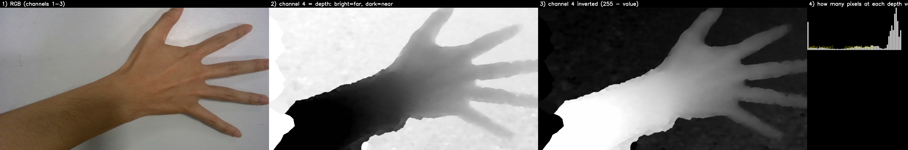
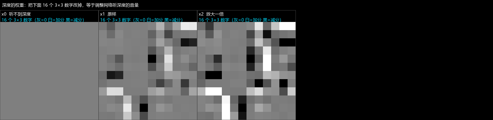
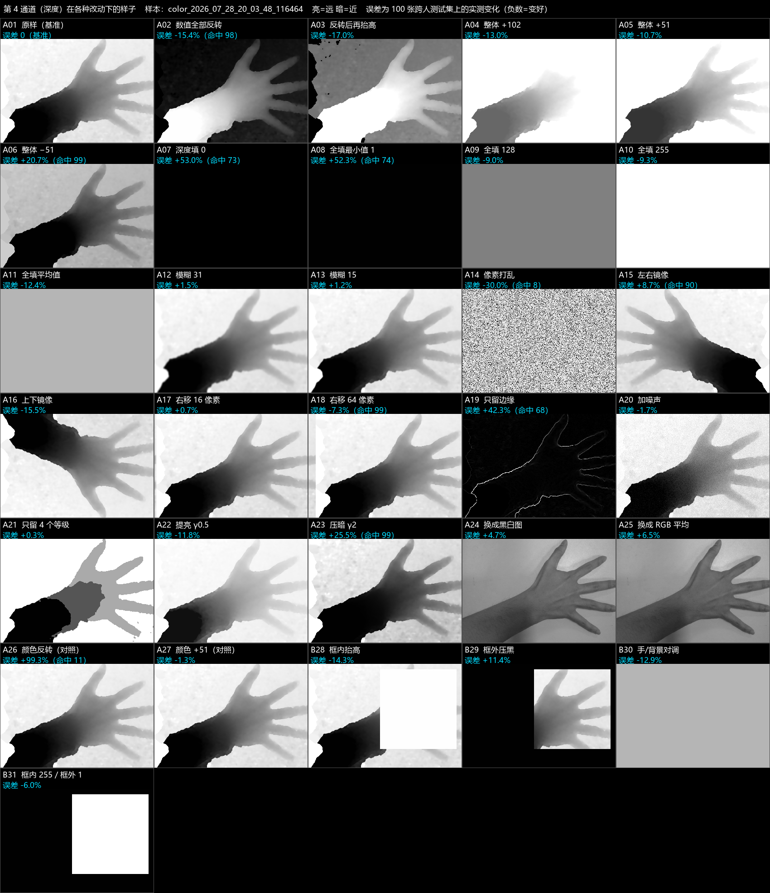

# 深度通道图册（看图理解第 4 通道）

> 这份文档只做一件事：把"第 4 通道长什么样""深度的权重长什么样""每种改动之后长什么样"画出来。
> 数字结论见 `02-Multi-YOLO-RGB.md`，这里不重复推导。

---

## 1. 一张图有 4 层数字

彩色图是 3 层（红、绿、蓝）。加上深度就是 **4 层**，第 4 层是一张额外的黑白图。



左起：

| 栏 | 内容 | 怎么看 |
|---|---|---|
| 1 | 彩色图（前 3 层合起来） | 正常照片 |
| 2 | **第 4 层 = 深度** | **越亮 = 越远，越暗 = 越近**。这里手是暗的、背景是亮的 |
| 3 | 第 4 层反转（每个数用 255 减） | 手变亮、背景变暗 |
| 4 | 深度值的分布 | 右边那根高柱是背景（数值集中在 255 附近），左边那堆是手 |

这张样本：有效像素 100%，深度平均值 181，最小 1、最大 255。

---

## 2. "深度的权重"是什么

网络第一层有 16 个小窗口（每个 3×3），每个窗口同时看 4 层数字：红、绿、蓝、深度。
**"深度的权重"就是这些小窗口里"专门看深度那一份"的 16 个 3×3 数字，一共 144 个数。**

这些数决定了网络"多听、怎么听"深度。把它们画成小方格：



| 面板 | 含义 | 人话 |
|---|---|---|
| `x0` | 144 个数全改成 0 | **把听深度的音量拧到 0**。图完全不变，但网络再也收不到深度 |
| `x1` | 训练出来的原值 | 正常音量 |
| `x2` | 每个数乘 2 | **音量调大一倍**。图也不变，网络对深度更敏感 |

灰底 = 0；白色 = 正数（这一格亮时加分）；黑色 = 负数（这一格亮时减分）。
对比 `x1` 和 `x2`：格子的亮暗格局一模一样，只是 `x2` 更极端。

**注意区分两件事：**

| 说法 | 改的是 | 图会变吗 |
|---|---|---|
| 把深度填 0 | 第 4 层数字全改成 0 | 会，整层变黑 |
| 把深度权重置 0 | 网络里那 144 个数全改成 0 | 不会，图一模一样的 |

---

## 3. 每种改动之后，第 4 层长什么样

同一张样本图，31 种改动。**每格左上角直接写了短名和实测误差**，不用再对照表格。



| 编号 | 具体怎么改 | 定位误差变化 |
|---|---|---|
| A01 | 原样（基准） | — |
| A02 | 每个数用 255 减（整体反转） | **−15.4%** |
| A03 | 先反转，再整体 +102 | **−17.0%** |
| A04 | 每个数 +102（≈ 往远推 300mm） | **−13.0%** |
| A05 | 每个数 +51 | −10.7% |
| A06 | 每个数 −51 | +20.7% |
| A07 | 深度填 0（整层变黑） | **+53.0%** |
| A08 | 有效区全填最小值 1（看着也几乎全黑） | **+52.3%** |
| A09 | 有效区全填 128（整层变灰） | −9.0% |
| A10 | 有效区全填 255（整层变白） | −9.3% |
| A11 | 有效区全填该图平均值（浅灰一块） | −12.5% |
| A12 | 大模糊（31） | +1.5% |
| A13 | 小模糊（15） | +1.2% |
| A14 | 像素位置整体打乱（变成雪花） | 命中只剩 8 张，不可比 |
| A15 | 左右镜像 | +8.7%（90 张） |
| A16 | 上下镜像 | **−15.5%** |
| A17 | 右移 16 像素 | +0.7% |
| A18 | 右移 64 像素 | −7.3%（99 张） |
| A19 | 只留边缘 | +42.3%（68 张） |
| A20 | 加噪声 | −1.7% |
| A21 | 只留 4 个等级 | +0.3% |
| A22 | 提亮（γ=0.5） | **−11.8%** |
| A23 | 压暗（γ=2） | +25.5% |
| A24 | 第 4 层换成原图黑白版 | +4.7% |
| A25 | 第 4 层换成 RGB 平均 | +6.5% |
| A26 | 改颜色（颜色反转，深度不动） | +99.3%（11 张） |
| A27 | 改颜色（颜色 +51，深度不动） | −1.3% |
| B28 | 按框：手区域抬到 254，其余不动 | **−14.3%** |
| B29 | 按框：背景压到 1，手不动 | +11.4% |
| B30 | 按框：手与背景的数值对调（差不变） | **−12.9%** |
| B31 | 按框：手涂 255、背景涂 1 | −6.0% |

---

## 4. 光看图就能明白的几件事

1. **A01 → A02**：图整个反过来了（手从暗变亮）。结果变好 15%。
2. **A07 和 A08 看起来几乎一样（都全黑），但结果都是最差的一档**（+53% / +52%）。
   说明"把深度压到底"不管填 0 还是填 1，都一样糟。
3. **A09 / A10 / A11 看起来是"一块均匀的灰色/白色"**，没有手的形状，结果却都变好（−9% ~ −12%）。
   说明网络不需要手的轮廓，只要数值别太低。
4. **A12 / A13 / A17 / A21 肉眼几乎看不出区别**（模糊、错位、降精度），结果也确实几乎不变（±2%）。
5. **A14 变成雪花**，网络直接崩了（只剩 8 张找得到）——它认的是"位置和数值的对应"，不是统计量。
6. **A15 左右镜像让手跑到右边**，变差 8.7%；**A16 上下镜像**，变好 15.5%。同样翻图，方向不同结果相反。
7. **A26 / A27 只改颜色**，对结果几乎没影响（−1.3%）或直接崩（+99%）→ 这些效应是第 4 层特有的。
8. **B28 的白色方块就是标注框**，把框内涂亮就能降 14.3%；**B29 反过来把背景涂黑**，反而更差 11.4%。

---

## 5. 怎么重新生成这些图

```bat
cd /d H:\YJJ\Yolo_RGBD\MultiYoloRGB
.venv\Scripts\python.exe show_depth_channel.py                    :: 图 1
.venv\Scripts\python.exe render_depth_gallery.py                  :: 图 2 + 图 3
```

产物在 `runs/depth_channel_view.png` 与 `runs/depth_gallery/`，
编号对照在 `runs/depth_gallery/variant_index.csv`。
